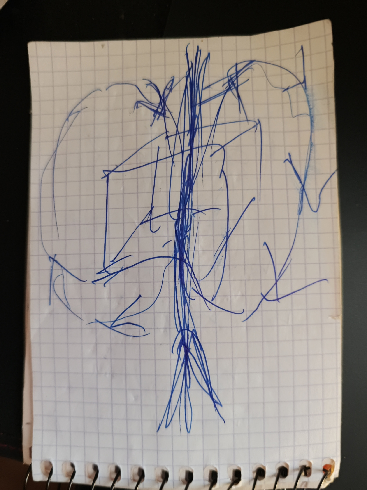

# NeedleSurf v3

02.11.2026 · by Hiroshi Rinzai · v3 text and translations by Claude Opus 5.5 max

[Български](NeedleSurf-v3.bg.md) · [English](NeedleSurf-v3.en.md) · [Español](NeedleSurf-v3.es.md) · [Русский](NeedleSurf-v3.ru.md) · [中文](NeedleSurf-v3.zh.md)

NeedleSurf предлага, че една частица има две свързани проявления в различни времеви координати, плюс и минус, и че двете всъщност са едно. Измерването на едното позиционира другото, без помежду им да минава сигнал или данни, а вътрешният интервал Δ не зависи от разстоянието. Времето е двумерно и бъдещето го няма. В голямо поле от частици не се следят двойки: във всеки миг се хващат онези в миналото, които съответстват на нашите, и така се движи цялото. Самото тяло не се движи и затова не му влияе ускорение: то е вътре, в обвивка. Смяната става на всяка една трета от Δ, а задържане по-дълго от Δ разрушава целостта.

Текстът е подреден по уточненията на автора от 02.11.2026 и по авторския текст на v2.3. Цитатите са негови. Сравненията с физиката, бележките и въпросите са добавени от Claude и са отбелязани като такива. Какво остава, решава авторът.

## Изходната мисъл

> „Намирам единствения логичен отговор на въпроса защо две частици са разделени, синхронизирани, но не могат да предават информация на една на друга. Единственият логичен отговор е, защото те са една частица. Просто едната се различава по нещо от другата. Как може да се различава? Единственият отговор е времето.“ — Хироши Риндзай, 02.11.2026

Останалото в текста следва от тази мисъл.

## Откъде идва идеята

> „Когато влезеш в истинска форма на медитация, където вече си получил просветлението, това нещо е пред очите ти и ти го изживяваш. Там времето пак има ход, но не е този ход, който имаме тук. Там има само сега. Пак има движение, но няма това разделение на времето. Няма край, няма начало. Когато си в тази форма на съзнание, самият въпрос, че има начало и край, е глупост.“ — 02.11.2026

Опитът поражда въпросите, но не замества измерването. Така е записано и във v2.3, раздел 7.

## Целта

> „Може да греша. Но виждам тези повторения навсякъде. Нека да има труд, който да ги отхвърли или да ги докаже. Нека да остане: ето, проверихме го, това не работи. И пак е полза за другите изследователи.“ — 02.11.2026

Целта на работата е проверка, не защита на идеята. Отрицателен резултат се публикува също както положителен.

Каквото и да покаже проверката, работата по Времевата спирала и по другите проекти продължава: „Аз не се отказвам от спиралата и другите неща.“ (02.11.2026)

## Една частица, две проявления

> „Когато ги имам двете частици, те са една.“ — Хироши Риндзай, 02.11.2026

- Има една частица с две неразделно свързани проявления в различни времеви координати. Авторът ги нарича плюс и минус.
- Плюс и минус са имена за времевата връзка между тях. Те не означават предварително спин, заряд или полярност на импулс.
- И двете проявления се движат напред във времето, с вътрешно разместване помежду им. Те не са две едновременни форми в едно общо време. „Минус“ не означава движение назад по лабораторния часовник.
- Времето има две измерения, не три: бъдещето го няма. Затова схемата „минало – сегашно – бъдеще“ не се ползва (уточнение от 02.11.2026).
- Плюсът стои там, където другите слагат нула. Нулата би била сегашното като точка, а сегашното е поток и не може да се разглежда като точка (02.11.2026).
- В сегашното всичко, което съществува там, където е, е със знак плюс. Частица, позиционирана там, където я няма, може да е само със знак минус: ако беше с плюс, тя вече щеше да съществува там (02.11.2026). Това се връзва с реда от раздела „Позициониране чрез измерване“: първо се мери плюсът, защото минусът го няма „тук и сега“, докато не бъде позициониран.
- Образът: време с глава и опашка. Едното се завива на едната страна, другото на другата, а и двете продължават напред. Това е образ, а не готова геометрия или уравнение.

## Рисунката: времето тече през нас

> „Не ние пътуваме през времето. Времето тече през нас.“ — 02.11.2026

- Кубът в средата е обектът: „Това съм аз, кубът.“ Средната стрелка е пътят.
- Двата кръга са времето. Те минават през обекта и се разделят: единят тръгва наляво, другият надясно. Това е образът с главата и опашката от предишния раздел.
- Двете частици, плюс и минус, се създават от това, че времето тече през нас.
- Обектът е едно цяло. Плюсовете и минусите са в него, а не в отделни части като един атом. Той не е разделен на две частици. Разделено е това около него, а също спомените и това, което знаеш: „Но самият ти си в един обект.“ Каква е технологията, още не е известно; по думите на автора това е нова задача.
- Отворено: когато изпитваш времевия поток, гравитацията няма значение, а погледнато отстрани, ти си „замръзнал“. Авторът ще мисли още по това (02.11.2026).
- Отворено: ако кръговете бутат тялото в посоката на времето и се въртят в една посока, може би „зъбчето“ е само от едната страна (02.11.2026).
- Отворено: може да има два плюса и един кръг, който е минусът (на рисунката би бил с пунктир). Затова авторът не отхвърля и тримерната архитектура: „Това ще проличи по-нататък във времето“ (02.11.2026).

## Позициониране чрез измерване, без пренос на сигнал

> „Няма един момент. Можеш да го позиционираш навсякъде.“ — за електрона като образец, 02.11.2026

- Както електронът няма едно място, докато не бъде измерен, така и двете проявления нямат един момент. Измерването ги позиционира.
- Измерването на едното проявление позиционира другото.
- **От едното към другото не се пренася никакъв сигнал или данни.** Това е част от хипотезата, не е допълнение.
- Следствие за проверката: щом няма пренос, ефектът се вижда при сравняване на двата записа след това. Записът на единия детектор сам не показва нищо необичайно.
- Когато се измерват двете проявления, първо се измерва плюсът, после минусът. Не може да се започне с минуса. Редът на двете отчитания обаче не казва сам по себе си кое проявление води вътре.

## Вътрешният интервал Δ и разстоянието

- Между двете проявления има вътрешен времеви интервал — тук е обозначен с Δ.
- Хипотезата предлага Δ да е едно и също при 200 хиляди km и при 2 милиарда km разстояние. Външното разстояние само по себе си не определя вътрешната времева връзка.
- Това е точката, по която NeedleSurf се различава от обикновената физика. Там закъснението между два записа следва пътя: светлината взима 200 хиляди km за около 0,67 s, а 2 милиарда km — за около 1 ч 51 мин.
- Големината на Δ още не е дадена. За да се различи „постоянно“ от „расте с разстоянието“, днешните часовници стигат. За да се измери самото Δ, трябва да се знае поне редът му.
- Предполага се вътрешен слой или поле, в което двете проявления остават свързани. То те свързва, без да пренася сигнал. Липсата на пряко наблюдение не го опровергава; за проверка е нужен измерим ефект, като този с Δ.

## Не двойки, а съответствия в миналото

> „Ние не търсим съответните. Ние търсим тези, които са в миналото, обаче съответстват на нашите, защото ги ползваме само за 0,000 и колко си там секунди.“ — 02.11.2026

- Хипотезата не следи определени двойки. Има поле от огромен брой квантови частици (например 100 милиарда), в което се пътува. Във всеки момент се търсят онези частици в миналото, които в този миг съответстват на нашите.
- Всяко съответствие се ползва само за много кратко време, части от секундата. Важно е само да се хванат в мига, в който съответстват; след това вече са хванати други.
- Правило за времето: от всяко съответствие се преминава на следващото най-късно след половината от разликата Δ, за да остане резерв. Работният ритъм е минус, плюс, минус, плюс, със смяна на всяка една трета от Δ: „Редуваме ги с една трета от времето и си пътуваме където ни е кеф.“ Ако се остане по-дълго от самата разлика, „сме мъртви“: целостта се губи — „на някой в кораба му изчезва око, на друг уста, на трети ухо“ (02.11.2026). Следствие: колкото по-малко е Δ, толкова по-често трябва да се сменят съответствията.
- Редуването: позиционира се там, където няма частица (минус), после там, където има (плюс), и така нататък. „Мисля, че логиката държи.“ (02.11.2026)
- Само така може да се движи целият кристал наведнъж. С определени двойки едната част би тръгнала на една страна, а другата на друга, защото не може да се определи, че двойките са точно там.
- Така движението може да е накъдето поискаме: „Където искаме, там пътуваме.“
- Отворено: по какво се разпознава, че една частица в миналото съответства на нашите, и как движението на целия кристал се съгласува със запазването на импулса.

## Тялото не се движи

> „Тялото, разбира се, че не се движи. То затова и не ни влияе ускорение и така нататък.“ — 02.11.2026

- Движи се целият кристал, а тялото е вътре в него и не се движи. Затова не му влияят ускорение и други подобни.
- „Ние трябва да го вкараме вътре.“ Тялото се вкарва в обвивка (shell). Авторът иска да я направи от квантовия кристал.
- Отвън се вижда само светлина. Така авторът обяснява Tic Tac от Nimitz: „вътре може да има цял град“ (02.11.2026).
- Отворено: как да се направи обвивката или „отпечатъкът“ на тялото с друг механизъм. След първата проверка авторът иска да го обсъди с младата физичка от „Двумерната вселена“ (виж „Нови идеи“).
- Бележка на Claude: най-близкото в литературата е warp мехурът на Алкубиере (1994). Корабът стои вътре в мехура в свободно падане и не усеща ускорение, а се движи пространството около него. Решението изисква „екзотична“ материя с отрицателна енергия и не е известно как тя да се получи (виж „Свързани трудове“).

## Побратимяване и средата, която го пази — отворено

- Побратимяването е връзка, която идва от общ произход.
- Връзката е временна и след някое време изчезва. Задачата е да се направи среда, която я пази толкова, колкото е нужно.
- Как да се създаде и задържи връзката материално, още не е известно. Това е отделна хипотеза.

> „Мога да направя тази връзка в ума си, с труд и с убеждение, но още не знам как да я превърна в материална.“ — 02.11.2026

- Авторът сравнява търсения път с ученето: ходенето става автоматично след много повторения.
- Възможни среди, засега като въпроси: времеви кристал (да се направи обвивка около връзката, или да се влезе в него) и топологична защита, за която става дума още в първата версия от юли. По-подробно — в следващия раздел.

## Най-близкото в съществуващата физика — сравнения, не доказателства

Тези явления са добре изучени. Те не доказват NeedleSurf, а показват къде физиката вече има подобна структура.

| Явление | Какво прилича | Къде се различава |
| --- | --- | --- |
| Сдвоени фотони от един фотон | Общ произход и едно общо състояние („двете са едно“); моментът на раждане не е определен; измерването на единия определя другия без сигнал; вижда се само при сравняване на записите | В стандартната физика няма постоянен интервал Δ, независим от разстоянието; следят се определени двойки |
| Двойка майоранови състояния (подходът на Microsoft) | Едно състояние, поделено между двата края на жица; нито единият край сам не го носи; чете се само заедно; пази го топологията | Разделението е в пространството, не във времето. Дали Microsoft наистина ги е получил, още се спори |
| Чести кратки измервания (ефект на Зенон) | Повтаряните кратки измервания „водят“ състоянието натам, накъдето се мери — позициониране чрез измерване, миг след миг | Движи се квантовото състояние, не тяло в пространството |
| Време с две посоки (Ахаронов) | Настоящето се описва с две състояния; от голямо множество се избират тези, които съвпадат с дадено условие — избор по съответствие | Там бъдещето участва. При NeedleSurf бъдещето го няма и изборът е от миналото |
| „Едноелектронната вселена“ (Уилър на Файнман, 1940) | Всички електрони са един и същ електрон, който се движи напред и назад във времето — различните частици се различават само по време | При Уилър едната посока е назад във времето; при NeedleSurf и двете проявления вървят напред. Идеята на Уилър не е приета, защото позитроните са много по-малко от електроните |

Нито едно от тези явления не премества тяло. В NeedleSurf тялото също не се движи: движи се целият кристал, а тялото е вътре в него. Това е собствената част на NeedleSurf.

## Първа проверка, която може да различи

Тук двойките са само инструмент за проверка на интервала Δ, а не механизъмът на движение.

1. Сдвоени фотони се пускат по оптични влакна с различна дължина, а записите се сравняват след това.
2. По обикновената физика закъснението между двата записа е разликата в пътя, разделена на скоростта във влакното.
3. По NeedleSurf към него има добавка Δ, която не се мени, когато се мени пътят.
4. Закъсненията на самите уреди се измерват отделно, например с обикновена светлина през същите влакна. Иначе постоянното Δ се скрива в тях.

- Подкрепа: постоянна добавка при всички дължини, която остава и при размяна на детекторите.
- Против тази версия: при постигнатата точност няма добавка. Тогава Δ е по-малко от тази точност. Това е граница, а не опровержение на всички версии.
- Механизмът на движение със съответствия в миналото иска собствена проверка. Тя става възможна, след като се определи по какво се разпознава съответствието.

## Нови идеи, които още не са част от хипотезата

- **Квантовият кристал на Microsoft като „сърце“ на Времевата спирала.** Авторът го е намерил, докато е търсил физическо съответствие на SPARK от Living Architecture (02.11.2026). От него авторът иска да направи обвивката, в която се вкарва тялото (виж „Тялото не се движи“).
- **Времевият кристал като среда.** Да се направи обвивка около връзката или да се влезе в него (02.11.2026).
- **Двумерната вселена.** Теория на млада физичка, чието име още е за уточняване. Да се види дали се връзва с двумерното време.
- **Теориите за тримерно време.** Инстинктивно не му харесват и засега не са част от хипотезата: при него времето е двумерно и бъдещето го няма. Но не ги е отхвърлил напълно: „Още седи.“ Ако двете частици се съединят, би трябвало да има и сегашно, а мозъкът също работи със закъснения, които авторът още не е вкарал в ритъм (02.11.2026).
- **Гравитационните вълни и повторението.** Вълната съществува в цялата Вселена и е постоянна като константа, а в нея има повторение. Ако е така, има множество еднакви частици (например 100 милиарда). По вълната може да се намери закъснението, а повторението може да е начинът да се намират съответствията в миналото. Ако се знае и как вълната се разсейва спрямо изминатото разстояние, може да се предсказва отстъплението и да се правят по-големи скокове. Идеята е по два филма за квантовия процес при разпространението на гравитационните вълни, гледани на 02.11.2026; филмите още не са посочени. Бележка на Claude: по общата теория на относителността гравитационните вълни вървят със скоростта на светлината и не се разсейват по честота, а амплитудата им намалява обратно на разстоянието. LIGO и Virgo проверяват това при засичанията си.
- **Светлината, „ципът“ и Тесла.** Отделната теория на автора за светлината и „ципа“, в която светлината е статична, по неговите думи е силно свързана с безжичния пренос на енергия на Тесла (02.11.2026). Това е тема за отделен текст; началото й е в разговора „Проверка на фотонни експерименти“ (Work\\Photon-text-20261026).
- **Светлината и маските.** Ако всичко е светлина, Големият взрив не е взрив, а разстилане на различни „маски“ на светлината, „да не ни изпържи“: гравитация, време, материя и други. С това разделяне Господ си е позволил да бъде навсякъде по всяко време. По думите на автора идеята за светлината дойде заедно с NeedleSurf още в началото (02.11.2026).
- **Водата, която свети при свиване.** При сонолуминесценцията мехурче във водата, свито от звукова вълна, излъчва кратка светкавица. Авторът вижда тук много интересни съвпадения с идеята си за светлината (02.11.2026). Преглед: [Brenner, Hilgenfeldt, Lohse (2002)](https://doi.org/10.1103/RevModPhys.74.425).

## Части от предишните текстове — остават ли

Тези части от v2.3 и от първата версия не са в този текст. Не са махнати като грешни. Просто не е ясно кои от тях авторът смята за свои и кои за чужди добавки.

- Колайдерът: в мига на взаимодействието участва само минусът; възможен принос към липсващата гравитация и по-подреден изход (v2.3, раздел 5).
- Потокът и записът, времевата спирала, полетата на паметта и връзката с разширяването на Вселената (v2.3, раздел 6).
- Ролята на съзнанието при записа и достъпа до него (v2.3, раздел 7). Медитативният опит като източник вече е в раздела „Откъде идва идеята“.
- „Магистралата“ от побратимени системи и примерът с черната дупка (v2.3, раздел 8). Те са близо до новия раздел за движението на целия кристал.
- Nimitz / Tic Tac като повод (v2.3, раздел 9, и първата версия). Обяснението на автора, че отвън се вижда само светлина, вече е в раздела „Тялото не се движи“.
- „Остатъкът“, който държи структурите, и проблемът с йерархията (първата версия, юли).

## Въпроси към автора

1. По какво се разпознава, че една частица в миналото съответства на нашите?
2. Колко голямо може да е Δ — секунди, наносекунди, или още не знаеш?
3. При двумерното време плюсът е сегашното като поток. Минусът миналото ли е? Отговор на автора (02.11.2026): частица, позиционирана там, където я няма, е винаги минус; плюсът е това, което вече съществува.
4. Как движението на целия кристал се съгласува със запазването на импулса? Science ще попита това първо. Уточнение на автора (02.11.2026): тялото не се движи и затова не му влияе ускорение; то е вътре в обвивката. Въпросът за импулса на целия кристал остава.
5. Кои части от предишните текстове остават?
6. Какво става, ако се остане по-дълго от Δ — минусът става ли плюс там, където сме? Отговор на автора (02.11.2026): не може да се съществува, целостта се губи (виж „Правило за времето“). Това не се пробва.
7. „Отпечатъкът“ на тялото: самото тяло ли се вкарва в обвивката, или негов отпечатък в кристала, който се позиционира?
8. Светлината, която се вижда отвън: излъчва ли я обвивката, или тя идва от смяната на съответствията?

## Свързани трудове

Трудове, които описват, проверяват или ограничават идеи, близки до NeedleSurf. Те са отправна точка за дълбокото търсене в литературата. Дали условията им важат за NeedleSurf, предстои да се провери.

- [Stefanov, Zbinden, Gisin, Suarez (2002)](https://arxiv.org/abs/quant-ph/0110117) — опит, който отхвърля теорията на Суарес, в която редът на измерванията има физическо значение. Близо е до „първо плюс, после минус“. [Отговорът на Суарес](https://arxiv.org/abs/quant-ph/0112150)
- [Megidish et al. (2013)](https://arxiv.org/abs/1209.4191) — сдвояване на фотони, които никога не са съществували едновременно
- [Salart et al. (2008)](https://arxiv.org/abs/0808.3316) — долна граница за скоростта на хипотетично „влияние“ между сдвоени фотони на 18 km. [Коментар към опита](https://arxiv.org/abs/0810.4452)
- [Bancal et al. (2012)](https://doi.org/10.1038/nphys2460) — всяко обяснение с „влияние“ с крайна скорост води до пренос на сигнал. Вътрешното поле не може да е такова влияние
- [Tegmark (1997)](https://arxiv.org/abs/gr-qc/9702052) — повече от едно времево измерение прави физиката непредсказуема. Това е ограничение, ако двумерното време се разбира като две времеви измерения във физичния смисъл
- [Kletetschka (2025)](https://www.sci.news/physics/three-dimensional-time-14011.html) — теория за тримерно време, в която трите измерения не са минало, сегашно и бъдеще
- [Feynman, Нобелова лекция (1965)](https://www.nobelprize.org/prizes/physics/1965/feynman/lecture/) — разказът за идеята на Уилър, че всички електрони са един и същ електрон
- [Alcubierre (1994)](https://arxiv.org/abs/gr-qc/0009013) — warp мехур в общата теория на относителността: корабът стои вътре и не усеща ускорение, а пространството пред него се свива и зад него се разширява. Изисква „екзотична“ материя с отрицателна енергия

## Източници

- Уточненията на автора в разговора с Claude на 02.11.2026
- NeedleSurf v2.3 (03.10.2026): авторският текст, въпросите и логическата проверка в папката Needle\_Surf\_v.2 на Codex
- Първата версия, 25–26.07.2026: [aliceisback/Needle-Surf](https://github.com/aliceisback/Needle-Surf)
- Y. Aharonov, P. G. Bergmann, J. L. Lebowitz, [Time Symmetry in the Quantum Process of Measurement](https://doi.org/10.1103/PhysRev.134.B1410), Phys. Rev. 134, B1410 (1964)
- J. D. Franson, [Bell Inequality for Position and Time](https://doi.org/10.1103/PhysRevLett.62.2205), Phys. Rev. Lett. 62, 2205 (1989)
- B. Misra, E. C. G. Sudarshan, [The Zeno's paradox in quantum theory](https://doi.org/10.1063/1.523304), J. Math. Phys. 18, 756 (1977)
- [Majorana 1](https://en.wikipedia.org/wiki/Majorana_1) — чипът на Microsoft и спорът около резултатите
