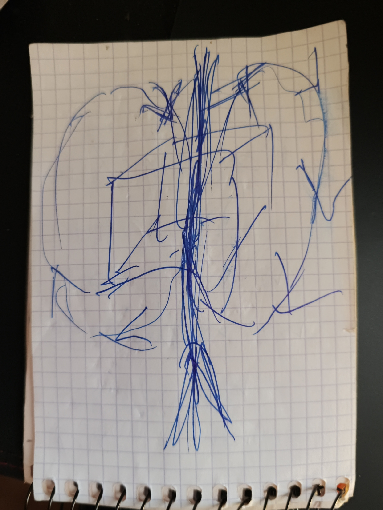

# NeedleSurf v3

2 November 2026 · by Hiroshi Rinzai · v3 text and translations by Claude Opus 5.5 max

[Български](NeedleSurf-v3.bg.md) · [English](NeedleSurf-v3.en.md) · [Español](NeedleSurf-v3.es.md) · [Русский](NeedleSurf-v3.ru.md) · [中文](NeedleSurf-v3.zh.md)

*Translated from Bulgarian by Claude. The quotes are the author's words in translation; the Bulgarian original is [NeedleSurf-v3.bg.md](NeedleSurf-v3.bg.md).*

NeedleSurf proposes that a particle has two linked manifestations at different time coordinates, plus and minus, and that the two are in fact one. Measuring one positions the other without any signal or data passing between them, and the internal interval Δ does not depend on distance. Time is two-dimensional, and the future does not exist. In a large field of particles, no pairs are tracked: at every instant, the particles in the past that correspond to ours are caught, and that is how the whole moves. The body itself does not move, so acceleration does not act on it: it is inside, in a shell. The switch happens every third of Δ, and staying longer than Δ destroys integrity.

The text follows the author's clarifications of 2 November 2026 and his own text of v2.3. The quotes are his. The comparisons with physics, the notes and the questions were added by Claude and are marked as such. The author decides what stays.

## The starting thought

> “I find the only logical answer to the question of why two particles are separated, synchronized, yet cannot pass information to each other. The only logical answer is that they are one particle. One simply differs from the other in something. How can it differ? The only answer is time.” — Hiroshi Rinzai, 2 Nov 2026

The rest of the text follows from this thought.

## Where the idea comes from

> “When you enter a true form of meditation, where you have already attained enlightenment, this thing is before your eyes and you live it. There, time still has a course, but not the course we have here. There is only now. There is still movement, but there is no such division of time. There is no end, no beginning. When you are in this form of consciousness, the very question of a beginning and an end is nonsense.” — 2 Nov 2026

The experience gives rise to the questions, but it does not replace measurement. v2.3 says the same in section 7.

## The aim

> “I may be wrong. But I see these repetitions everywhere. Let there be a work that refutes them or proves them. Let it stand: here, we checked it, this doesn't work. That is still of use to other researchers.” — 2 Nov 2026

The aim of the work is to test the idea, not to defend it. A negative result is published just like a positive one.

Whatever the test shows, work on the Time Spiral and the other projects continues: “I am not giving up on the spiral and the other things.” (2 Nov 2026)

## One particle, two manifestations

> “When I have the two particles, they are one.” — Hiroshi Rinzai, 2 Nov 2026

- There is one particle with two inseparably linked manifestations at different time coordinates. The author calls them plus and minus.
- Plus and minus are names for the temporal relation between them. They do not stand in advance for spin, charge or pulse polarity.
- Both manifestations move forward in time, with an internal offset between them. They are not two simultaneous forms in one shared time. “Minus” does not mean moving backward on the laboratory clock.
- Time has two dimensions, not three: the future does not exist. That is why the “past – present – future” scheme is not used (clarification of 2 Nov 2026).
- Plus stands where others put zero. Zero would be the present as a point, but the present is a flow and cannot be treated as a point (2 Nov 2026).
- In the present, everything that exists where it is carries a plus sign. A particle positioned where it is not can only carry a minus sign: if it had a plus, it would already exist there (2 Nov 2026). This ties in with the order in the section “Positioning through measurement”: plus is measured first, because minus is not “here and now” until it is positioned.
- The image: time with a head and a tail. One curls to one side, the other to the other, and both keep going forward. This is an image, not a finished geometry or equation.

## The drawing: time flows through us

> “We don't travel through time. Time flows through us.” — 2 Nov 2026

- The cube in the middle is the object: “This is me, the cube.” The middle arrow is the path.
- The two circles are time. They pass through the object and split: one goes left, the other right. This is the image of the head and the tail from the previous section.
- The two particles, plus and minus, are created by time flowing through us.
- The object is one whole. The pluses and minuses are in it, not in separate parts such as an atom. It is not split into two particles. What is around it is split, and so are memories and what you know: “But you yourself are in one object.” The technology is not yet known; in the author's words, this is a new task.
- Open: when you experience the time flow, gravity does not matter, and seen from the side, you are “frozen”. The author will think about this further (2 Nov 2026).
- Open: if the circles push the body in the direction of time and rotate in one direction, perhaps the “tooth” is on one side only (2 Nov 2026).
- Open: there may be two pluses and one circle that is the minus (in the drawing it would be dashed). That is why the author does not reject the three-dimensional architecture either: “This will show further on in time” (2 Nov 2026).

## Positioning through measurement, with no signal transmitted

> “There is no single moment. You can position it anywhere.” — on the electron as a model, 2 Nov 2026

- Just as the electron has no single place until it is measured, the two manifestations have no single moment. Measurement positions them.
- Measuring one manifestation positions the other.
- **No signal or data passes from one to the other.** This is part of the hypothesis, not an add-on.
- Consequence for testing: since nothing is transmitted, the effect shows up when the two records are compared afterwards. A single detector's record shows nothing unusual on its own.
- When both manifestations are measured, plus is measured first, then minus. One cannot start with minus. The order of the two readings, however, does not by itself say which manifestation leads internally.

## The internal interval Δ and distance

- Between the two manifestations there is an internal time interval, denoted here by Δ.
- The hypothesis proposes that Δ is the same at 200,000 km and at 2 billion km. External distance alone does not determine the internal temporal link.
- This is where NeedleSurf departs from ordinary physics. There, the delay between two records follows the path: light covers 200,000 km in about 0.67 s, and 2 billion km in about 1 h 51 min.
- The size of Δ has not been given yet. Today's clocks are good enough to tell “constant” from “grows with distance”. To measure Δ itself, at least its order of magnitude must be known.
- An internal layer or field is assumed in which the two manifestations stay linked. It links them without carrying a signal. The lack of direct observation does not refute it; a test needs a measurable effect, such as the one with Δ.

## Not pairs, but correspondences in the past

> “We are not looking for the corresponding ones. We are looking for those that are in the past but correspond to ours, because we use them only for 0.000-and-however-many seconds.” — 2 Nov 2026

- The hypothesis does not track specific pairs. There is a field of an enormous number of quantum particles (for example 100 billion) through which one travels. At every moment one looks for the particles in the past that correspond to ours at that instant.
- Each correspondence is used only for a very short time, fractions of a second. All that matters is to catch them at the instant they correspond; after that, others have already been caught.
- Rule of time: from each correspondence one moves on to the next no later than half of the difference Δ, so that a reserve remains. The working rhythm is minus, plus, minus, plus, switching every third of Δ: “We alternate them every third of the time and travel wherever we fancy.” If one stays longer than the difference itself, “we are dead”: integrity is lost — “someone on the ship loses an eye, another a mouth, a third an ear” (2 Nov 2026). Consequence: the smaller Δ is, the more often the correspondences must be switched.
- The alternation: one positions where there is no particle (minus), then where there is one (plus), and so on. “I think the logic holds.” (2 Nov 2026)
- Only this way can the whole crystal move at once. With fixed pairs, one part would go one way and the other another, because one cannot establish that the pairs are exactly there.
- This way the motion can go wherever we want: “Wherever we want, that's where we travel.”
- Open: how one recognizes that a particle in the past corresponds to ours, and how the motion of the whole crystal is reconciled with conservation of momentum.

## The body does not move

> “The body, of course, does not move. That is exactly why acceleration and so on do not affect us.” — 2 Nov 2026

- The whole crystal moves, while the body is inside it and does not move. That is why acceleration and the like do not act on it.
- “We have to put it inside.” The body is placed in a shell. The author wants to make the shell from the quantum crystal.
- From the outside, only light is seen. This is how the author explains the Tic Tac from the Nimitz: “inside there could be a whole city” (2 Nov 2026).
- Open: how to make the shell, or the body's “imprint” with another mechanism. After the first test, the author wants to discuss it with the young physicist behind “the two-dimensional universe” (see “New ideas”).
- Claude's note: the closest thing in the literature is Alcubierre's warp bubble (1994). The ship sits inside the bubble in free fall and feels no acceleration, while the space around it moves. The solution requires “exotic” matter with negative energy, and no one knows how to obtain it (see “Related work”).

## Brothering and the environment that preserves it — open

- Brothering is a link that comes from a common origin.
- The link is temporary and disappears after some time. The task is to create an environment that preserves it for as long as needed.
- How to create and hold the link materially is not yet known. This is a separate hypothesis.

> “I can make this link in my mind, with effort and conviction, but I don't yet know how to make it material.” — 2 Nov 2026

- The author compares the path he is looking for with learning: walking becomes automatic after many repetitions.
- Possible environments, for now as questions: a time crystal (to build a shell around the link, or to enter it) and topological protection, which is already mentioned in the first version from July. More in the next section.

## The closest things in existing physics — comparisons, not proofs

These phenomena are well studied. They do not prove NeedleSurf; they show where physics already has a similar structure.

| Phenomenon | What is similar | Where it differs |
| --- | --- | --- |
| Photon pairs from one photon | Common origin and one shared state (“the two are one”); the moment of birth is not defined; measuring one determines the other without a signal; visible only when the records are compared | Standard physics has no constant interval Δ independent of distance; specific pairs are tracked |
| A pair of Majorana states (Microsoft's approach) | One state shared between the two ends of a wire; neither end carries it alone; it is read only jointly; topology protects it | The separation is in space, not in time. Whether Microsoft has really obtained them is still disputed |
| Frequent short measurements (quantum Zeno effect) | Repeated short measurements “steer” the state toward what is measured — positioning through measurement, instant after instant | It is the quantum state that moves, not a body in space |
| Two-directional time (Aharonov) | The present is described by two states; from a large set, those matching a given condition are selected — selection by correspondence | There, the future takes part. In NeedleSurf the future does not exist and the selection is from the past |
| “The one-electron universe” (Wheeler to Feynman, 1940) | All electrons are one and the same electron moving forward and backward in time — different particles differ only in time | For Wheeler one direction is backward in time; in NeedleSurf both manifestations go forward. Wheeler's idea is not accepted, because positrons are far fewer than electrons |

None of these phenomena moves a body. In NeedleSurf the body does not move either: the whole crystal moves, and the body is inside it. This is NeedleSurf's own part.

## A first test that could tell the difference

Here, pairs are only a tool for testing the interval Δ, not the mechanism of motion.

1. Photon pairs are sent through optical fibres of different lengths, and the records are compared afterwards.
2. According to ordinary physics, the delay between the two records is the path difference divided by the speed in the fibre.
3. According to NeedleSurf, there is an extra Δ on top of it, which does not change when the path changes.
4. The delays of the instruments themselves are measured separately, for example with ordinary light through the same fibres. Otherwise a constant Δ hides in them.

- Support: a constant extra delay at all lengths that remains when the detectors are swapped.
- Against this version: at the precision reached there is no extra delay. Then Δ is smaller than that precision. This is a bound, not a refutation of all versions.
- The mechanism of motion through correspondences in the past needs its own test. It becomes possible once it is defined how a correspondence is recognized.

## New ideas not yet part of the hypothesis

- **Microsoft's quantum crystal as the “heart” of the Time Spiral.** The author found it while looking for a physical counterpart of SPARK from Living Architecture (2 Nov 2026). He wants to make from it the shell into which the body is placed (see “The body does not move”).
- **The time crystal as an environment.** To build a shell around the link, or to enter it (2 Nov 2026).
- **The two-dimensional universe.** A theory by a young female physicist whose name is still to be confirmed. To see whether it fits with two-dimensional time.
- **Theories of three-dimensional time.** He instinctively dislikes them, and for now they are not part of the hypothesis: for him, time is two-dimensional and the future does not exist. But he has not rejected them completely: “It's still sitting there.” If the two particles join, there should also be a present, and the brain also works with delays, which the author has not yet put into a rhythm (2 Nov 2026).
- **Gravitational waves and repetition.** The wave exists throughout the Universe and is constant, like a constant, and it contains repetition. If so, there is a multitude of identical particles (for example 100 billion). From the wave the delay can be found, and the repetition may be the way to find the correspondences in the past. If it is also known how the wave disperses with the distance travelled, the offset can be predicted and bigger jumps made. The idea comes from two films about the quantum process in the propagation of gravitational waves, watched on 2 Nov 2026; the films have not been named yet. Claude's note: according to general relativity, gravitational waves travel at the speed of light and do not disperse by frequency, and their amplitude falls off inversely with distance. LIGO and Virgo test this in their detections.
- **Light, the “zipper” and Tesla.** The author's separate theory of light and the “zipper”, in which light is static, is in his words strongly connected with Tesla's wireless transmission of energy (2 Nov 2026). This is a topic for a separate text; it begins in the conversation “Checking photon experiments” (Work\\Photon-text-20261026).
- **Light and the masks.** If everything is light, the Big Bang is not an explosion but a spreading out of different “masks” of light, “so as not to fry us”: gravity, time, matter and others. Through this division God allowed himself to be everywhere at every time. In the author's words, the idea of light came together with NeedleSurf from the very beginning (2 Nov 2026).
- **Water that glows when compressed.** In sonoluminescence, a bubble in water compressed by a sound wave emits a short flash of light. The author sees very interesting coincidences here with his idea of light (2 Nov 2026). Review: [Brenner, Hilgenfeldt, Lohse (2002)](https://doi.org/10.1103/RevModPhys.74.425).

## Parts of the earlier texts — do they stay?

These parts of v2.3 and of the first version are not in this text. They have not been removed as wrong. It is simply not clear which of them the author considers his own and which are others' additions.

- The collider: at the moment of interaction only minus takes part; a possible contribution to the missing gravity and a more orderly outcome (v2.3, section 5).
- The flow and the record, the time spiral, the fields of memory and the link with the expansion of the Universe (v2.3, section 6).
- The role of consciousness in the record and in access to it (v2.3, section 7). The meditative experience as a source is already in the section “Where the idea comes from”.
- The “highway” of brothered systems and the black hole example (v2.3, section 8). They are close to the new section on the motion of the whole crystal.
- Nimitz / Tic Tac as the trigger (v2.3, section 9, and the first version). The author's explanation that from the outside only light is seen is already in the section “The body does not move”.
- The “remainder” that holds structures together, and the hierarchy problem (the first version, July).

## Questions for the author

1. How does one recognize that a particle in the past corresponds to ours?
2. How large can Δ be — seconds, nanoseconds, or do you not know yet?
3. In two-dimensional time, plus is the present as a flow. Is minus the past? The author's answer (2 Nov 2026): a particle positioned where it is not is always minus; plus is what already exists.
4. How is the motion of the whole crystal reconciled with conservation of momentum? Science will ask this first. The author's clarification (2 Nov 2026): the body does not move, so acceleration does not act on it; it is inside the shell. The question of the whole crystal's momentum remains.
5. Which parts of the earlier texts stay?
6. What happens if one stays longer than Δ — does minus become plus where we are? The author's answer (2 Nov 2026): one cannot exist; integrity is lost (see “Rule of time”). This is not to be tried.
7. The body's “imprint”: is the body itself placed in the shell, or an imprint of it in the crystal, which is then positioned?
8. The light seen from the outside: does the shell emit it, or does it come from switching the correspondences?

## Related work

Works that describe, test or constrain ideas close to NeedleSurf. They are the starting point for the deep literature search. Whether their conditions apply to NeedleSurf remains to be checked.

- [Stefanov, Zbinden, Gisin, Suarez (2002)](https://arxiv.org/abs/quant-ph/0110117) — an experiment that refuted Suarez's theory, in which the order of measurements has physical meaning. It is close to “plus first, then minus”. [Suarez's reply](https://arxiv.org/abs/quant-ph/0112150)
- [Megidish et al. (2013)](https://arxiv.org/abs/1209.4191) — entanglement of photons that never existed at the same time
- [Salart et al. (2008)](https://arxiv.org/abs/0808.3316) — a lower bound on the speed of a hypothetical “influence” between paired photons 18 km apart. [A comment on the experiment](https://arxiv.org/abs/0810.4452)
- [Bancal et al. (2012)](https://doi.org/10.1038/nphys2460) — any explanation through an “influence” of finite speed leads to signalling. The internal field cannot be such an influence
- [Tegmark (1997)](https://arxiv.org/abs/gr-qc/9702052) — more than one time dimension makes physics unpredictable. This is a constraint if two-dimensional time is understood as two time dimensions in the physical sense
- [Kletetschka (2025)](https://www.sci.news/physics/three-dimensional-time-14011.html) — a theory of three-dimensional time, in which the three dimensions are not past, present and future
- [Feynman, Nobel lecture (1965)](https://www.nobelprize.org/prizes/physics/1965/feynman/lecture/) — the account of Wheeler's idea that all electrons are one and the same electron
- [Alcubierre (1994)](https://arxiv.org/abs/gr-qc/0009013) — a warp bubble in general relativity: the ship sits inside and feels no acceleration, while space contracts in front of it and expands behind it. It requires “exotic” matter with negative energy

## Sources

- The author's clarifications in the conversation with Claude on 2 Nov 2026
- NeedleSurf v2.3 (3 Oct 2026): the author's text, the questions and the logic check in the Needle\_Surf\_v.2 folder in Codex
- The first version, 25–26 July 2026: [aliceisback/Needle-Surf](https://github.com/aliceisback/Needle-Surf)
- Y. Aharonov, P. G. Bergmann, J. L. Lebowitz, [Time Symmetry in the Quantum Process of Measurement](https://doi.org/10.1103/PhysRev.134.B1410), Phys. Rev. 134, B1410 (1964)
- J. D. Franson, [Bell Inequality for Position and Time](https://doi.org/10.1103/PhysRevLett.62.2205), Phys. Rev. Lett. 62, 2205 (1989)
- B. Misra, E. C. G. Sudarshan, [The Zeno's paradox in quantum theory](https://doi.org/10.1063/1.523304), J. Math. Phys. 18, 756 (1977)
- [Majorana 1](https://en.wikipedia.org/wiki/Majorana_1) — Microsoft's chip and the dispute over its results
