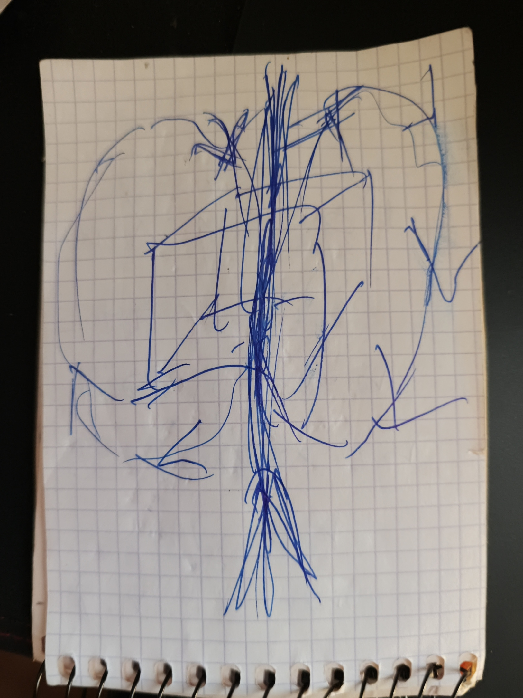

# NeedleSurf v3

2 de noviembre de 2026 · by Hiroshi Rinzai · v3 text and translations by Claude Opus 5.5 max

[Български](NeedleSurf-v3.bg.md) · [English](NeedleSurf-v3.en.md) · [Español](NeedleSurf-v3.es.md) · [Русский](NeedleSurf-v3.ru.md) · [中文](NeedleSurf-v3.zh.md)

*Traducción del búlgaro hecha por Claude. Las citas son palabras del autor traducidas; el original búlgaro está en [NeedleSurf-v3.bg.md](NeedleSurf-v3.bg.md).*

NeedleSurf propone que una partícula tiene dos manifestaciones vinculadas en coordenadas temporales distintas, más y menos, y que en realidad las dos son una sola. Medir una posiciona a la otra sin que pase entre ellas ninguna señal ni dato, y el intervalo interno Δ no depende de la distancia. El tiempo es bidimensional y el futuro no existe. En un gran campo de partículas no se siguen pares: en cada instante se captan las del pasado que corresponden a las nuestras, y así se mueve el conjunto. El propio cuerpo no se mueve y por eso la aceleración no actúa sobre él: está dentro, en una envoltura. El cambio se hace cada tercio de Δ, y quedarse más de Δ destruye la integridad.

El texto sigue las precisiones del autor del 2 de noviembre de 2026 y su propio texto de la v2.3. Las citas son suyas. Las comparaciones con la física, las notas y las preguntas las añadió Claude y están señaladas como tales. Lo que se queda lo decide el autor.

## La idea de partida

> «Encuentro la única respuesta lógica a la pregunta de por qué dos partículas están separadas, sincronizadas, pero no pueden transmitirse información la una a la otra. La única respuesta lógica es que son una sola partícula. Simplemente una se diferencia de la otra en algo. ¿En qué puede diferenciarse? La única respuesta es el tiempo». — Hiroshi Rinzai, 2 nov. 2026

Todo lo demás del texto se deriva de esta idea.

## De dónde viene la idea

> «Cuando entras en una verdadera forma de meditación, en la que ya has alcanzado la iluminación, esto está ante tus ojos y lo vives. Allí el tiempo sigue teniendo un curso, pero no es el curso que tenemos aquí. Allí solo existe el ahora. Sigue habiendo movimiento, pero no existe esa división del tiempo. No hay final ni principio. Cuando estás en esa forma de conciencia, la propia pregunta de un principio y un final es absurda». — 2 nov. 2026

La experiencia hace surgir las preguntas, pero no sustituye a la medición. Así consta también en la v2.3, sección 7.

## El objetivo

> «Puedo equivocarme. Pero veo estas repeticiones por todas partes. Que haya un trabajo que las refute o las demuestre. Que quede constancia: mira, lo comprobamos, esto no funciona. Y aun así es útil para otros investigadores». — 2 nov. 2026

El objetivo del trabajo es comprobar la idea, no defenderla. Un resultado negativo se publica igual que uno positivo.

Sea cual sea el resultado de la comprobación, el trabajo en la Espiral del Tiempo y en los demás proyectos continúa: «No renuncio a la espiral ni a las demás cosas». (2 nov. 2026)

## Una partícula, dos manifestaciones

> «Cuando tengo las dos partículas, son una sola». — Hiroshi Rinzai, 2 nov. 2026

- Hay una partícula con dos manifestaciones inseparablemente vinculadas en coordenadas temporales distintas. El autor las llama más y menos.
- Más y menos son nombres para la relación temporal entre ellas. No designan de antemano espín, carga ni polaridad de un impulso.
- Ambas manifestaciones avanzan en el tiempo, con un desfase interno entre ellas. No son dos formas simultáneas en un tiempo común. «Menos» no significa moverse hacia atrás en el reloj del laboratorio.
- El tiempo tiene dos dimensiones, no tres: el futuro no existe. Por eso no se usa el esquema «pasado – presente – futuro» (precisión del 2 nov. 2026).
- El más está donde otros ponen el cero. El cero sería el presente como un punto, pero el presente es un flujo y no puede tratarse como un punto (2 nov. 2026).
- En el presente, todo lo que existe donde está lleva signo más. Una partícula posicionada donde no está solo puede llevar signo menos: si llevara más, ya existiría allí (2 nov. 2026). Esto enlaza con el orden de la sección «Posicionamiento mediante la medición»: primero se mide el más, porque el menos no está «aquí y ahora» hasta que se posiciona.
- La imagen: un tiempo con cabeza y cola. Uno se curva hacia un lado, el otro hacia el otro, y ambos siguen avanzando. Es una imagen, no una geometría ni una ecuación acabadas.

## El dibujo: el tiempo fluye a través de nosotros

> «No somos nosotros los que viajamos a través del tiempo. El tiempo fluye a través de nosotros». — 2 nov. 2026

- El cubo del centro es el objeto: «Este soy yo, el cubo». La flecha del medio es el camino.
- Los dos círculos son el tiempo. Pasan a través del objeto y se separan: uno va hacia la izquierda y el otro hacia la derecha. Es la imagen de la cabeza y la cola de la sección anterior.
- Las dos partículas, más y menos, se crean porque el tiempo fluye a través de nosotros.
- El objeto es un todo. Los más y los menos están en él, no en partes separadas como un átomo. No está dividido en dos partículas. Lo que lo rodea está dividido, y también los recuerdos y lo que sabes: «Pero tú mismo estás en un solo objeto». Aún no se conoce la tecnología; según el autor, es una tarea nueva.
- Abierto: cuando experimentas el flujo del tiempo, la gravedad no importa, y visto desde fuera estás «congelado». El autor seguirá pensándolo (2 nov. 2026).
- Abierto: si los círculos empujan el cuerpo en la dirección del tiempo y giran en un solo sentido, quizá el «diente» esté solo en un lado (2 nov. 2026).
- Abierto: puede haber dos más y un círculo que sea el menos (en el dibujo iría con línea discontinua). Por eso el autor tampoco descarta la arquitectura tridimensional: «Esto se verá más adelante en el tiempo» (2 nov. 2026).

## Posicionamiento mediante la medición, sin transmisión de señal

> «No hay un único momento. Puedes posicionarlo en cualquier parte». — sobre el electrón como modelo, 2 nov. 2026

- Así como el electrón no tiene un único lugar hasta que se mide, las dos manifestaciones no tienen un único momento. La medición las posiciona.
- Medir una manifestación posiciona a la otra.
- **De una a otra no se transmite ninguna señal ni dato.** Esto forma parte de la hipótesis, no es un añadido.
- Consecuencia para la comprobación: como no hay transmisión, el efecto se ve al comparar después los dos registros. El registro de un solo detector no muestra por sí mismo nada inusual.
- Cuando se miden las dos manifestaciones, primero se mide el más y después el menos. No se puede empezar por el menos. Sin embargo, el orden de las dos lecturas no indica por sí solo qué manifestación va por delante internamente.

## El intervalo interno Δ y la distancia

- Entre las dos manifestaciones hay un intervalo temporal interno, que aquí se designa con Δ.
- La hipótesis propone que Δ es el mismo a 200 000 km y a 2000 millones de km de distancia. La distancia externa por sí sola no determina el vínculo temporal interno.
- Este es el punto en el que NeedleSurf se aparta de la física ordinaria. En ella, el retraso entre dos registros depende del recorrido: la luz tarda unos 0,67 s en recorrer 200 000 km, y cerca de 1 h 51 min en recorrer 2000 millones de km.
- El tamaño de Δ aún no se ha dado. Para distinguir «constante» de «crece con la distancia», los relojes actuales bastan. Para medir el propio Δ hay que conocer al menos su orden de magnitud.
- Se supone una capa o campo interno en el que las dos manifestaciones permanecen vinculadas. Las vincula sin transmitir señal. La falta de observación directa no lo refuta; para comprobarlo hace falta un efecto medible, como el de Δ.

## No pares, sino correspondencias en el pasado

> «No buscamos las correspondientes. Buscamos las que están en el pasado pero corresponden a las nuestras, porque las usamos solo durante 0,000 y no sé cuántos segundos». — 2 nov. 2026

- La hipótesis no sigue pares determinados. Hay un campo con un número enorme de partículas cuánticas (por ejemplo, 100 000 millones) a través del cual se viaja. En cada momento se buscan las partículas del pasado que en ese instante corresponden a las nuestras.
- Cada correspondencia se usa solo durante un tiempo muy corto, fracciones de segundo. Lo único importante es captarlas en el instante en que corresponden; después ya se han captado otras.
- Regla del tiempo: de cada correspondencia se pasa a la siguiente, como muy tarde, a la mitad de la diferencia Δ, para que quede un margen. El ritmo de trabajo es menos, más, menos, más, con un cambio cada tercio de Δ: «Las alternamos cada tercio del tiempo y viajamos adonde nos dé la gana». Si se permanece más tiempo que la propia diferencia, «estamos muertos»: se pierde la integridad — «a uno en la nave le desaparece un ojo, a otro la boca, a un tercero una oreja» (2 nov. 2026). Consecuencia: cuanto menor sea Δ, más a menudo hay que cambiar las correspondencias.
- La alternancia: se posiciona donde no hay partícula (menos), después donde sí la hay (más), y así sucesivamente. «Creo que la lógica se sostiene». (2 nov. 2026)
- Solo así puede moverse todo el cristal a la vez. Con pares determinados, una parte iría hacia un lado y la otra hacia otro, porque no se puede establecer que los pares estén exactamente ahí.
- Así el movimiento puede ir adonde queramos: «Adonde queremos, allí viajamos».
- Abierto: cómo se reconoce que una partícula del pasado corresponde a las nuestras, y cómo se concilia el movimiento de todo el cristal con la conservación del momento lineal.

## El cuerpo no se mueve

> «El cuerpo, por supuesto, no se mueve. Justamente por eso no nos afecta la aceleración, etcétera». — 2 nov. 2026

- Se mueve todo el cristal, mientras que el cuerpo está dentro de él y no se mueve. Por eso no actúan sobre él la aceleración ni cosas parecidas.
- «Tenemos que meterlo dentro». El cuerpo se coloca en una envoltura (shell). El autor quiere hacerla con el cristal cuántico.
- Desde fuera solo se ve luz. Así explica el autor el Tic Tac del Nimitz: «dentro puede haber una ciudad entera» (2 nov. 2026).
- Abierto: cómo hacer la envoltura, o la «huella» del cuerpo con otro mecanismo. Después de la primera prueba, el autor quiere hablarlo con la joven física del «universo bidimensional» (véase «Ideas nuevas»).
- Nota de Claude: lo más cercano en la literatura es la burbuja warp de Alcubierre (1994). La nave está dentro de la burbuja en caída libre y no siente aceleración, mientras que se mueve el espacio a su alrededor. La solución requiere materia «exótica» con energía negativa, y no se sabe cómo obtenerla (véase «Trabajos relacionados»).

## El hermanamiento y el medio que lo preserva — abierto

- El hermanamiento es un vínculo que proviene de un origen común.
- El vínculo es temporal y desaparece al cabo de un tiempo. La tarea es crear un medio que lo preserve tanto tiempo como haga falta.
- Aún no se sabe cómo crear y mantener el vínculo materialmente. Es una hipótesis aparte.

> «Puedo crear este vínculo en mi mente, con esfuerzo y convicción, pero aún no sé cómo convertirlo en algo material». — 2 nov. 2026

- El autor compara el camino que busca con el aprendizaje: caminar se vuelve automático después de muchas repeticiones.
- Medios posibles, por ahora como preguntas: un cristal de tiempo (construir una envoltura alrededor del vínculo, o entrar en él) y la protección topológica, que ya se menciona en la primera versión, de julio. Más detalles en la sección siguiente.

## Lo más cercano en la física actual: comparaciones, no pruebas

Estos fenómenos están bien estudiados. No demuestran NeedleSurf, sino que muestran dónde la física ya tiene una estructura parecida.

| Fenómeno | En qué se parece | En qué se diferencia |
| --- | --- | --- |
| Pares de fotones nacidos de un solo fotón | Origen común y un único estado compartido («las dos son una»); el momento del nacimiento no está definido; medir uno determina el otro sin señal; solo se ve al comparar los registros | En la física estándar no hay un intervalo constante Δ independiente de la distancia; se siguen pares determinados |
| Un par de estados de Majorana (el enfoque de Microsoft) | Un solo estado repartido entre los dos extremos de un hilo; ningún extremo lo lleva por sí solo; solo se lee de forma conjunta; lo protege la topología | La separación está en el espacio, no en el tiempo. Aún se discute si Microsoft los ha obtenido de verdad |
| Mediciones breves y frecuentes (efecto Zenón cuántico) | Las mediciones breves repetidas «guían» el estado hacia lo que se mide: posicionamiento mediante la medición, instante tras instante | Lo que se mueve es el estado cuántico, no un cuerpo en el espacio |
| El tiempo con dos direcciones (Aharonov) | El presente se describe con dos estados; de un gran conjunto se eligen los que cumplen una condición dada: selección por correspondencia | Allí participa el futuro. En NeedleSurf el futuro no existe y la selección se hace desde el pasado |
| «El universo de un solo electrón» (Wheeler a Feynman, 1940) | Todos los electrones son uno y el mismo electrón, que se mueve hacia delante y hacia atrás en el tiempo: las distintas partículas solo se diferencian en el tiempo | En Wheeler una dirección es hacia atrás en el tiempo; en NeedleSurf las dos manifestaciones avanzan. La idea de Wheeler no se acepta porque hay muchos menos positrones que electrones |

Ninguno de estos fenómenos desplaza un cuerpo. En NeedleSurf el cuerpo tampoco se mueve: se mueve todo el cristal y el cuerpo está dentro de él. Esta es la parte propia de NeedleSurf.

## Una primera prueba que puede distinguir

Aquí los pares son solo una herramienta para comprobar el intervalo Δ, no el mecanismo del movimiento.

1. Se envían pares de fotones por fibras ópticas de distinta longitud y después se comparan los registros.
2. Según la física ordinaria, el retraso entre los dos registros es la diferencia de recorrido dividida por la velocidad en la fibra.
3. Según NeedleSurf, a eso se suma un Δ que no cambia cuando cambia el recorrido.
4. Los retrasos de los propios aparatos se miden por separado, por ejemplo con luz ordinaria a través de las mismas fibras. De lo contrario, un Δ constante se esconde en ellos.

- A favor: un añadido constante en todas las longitudes, que se mantiene al intercambiar los detectores.
- En contra de esta versión: con la precisión alcanzada no hay añadido. Entonces Δ es menor que esa precisión. Esto es un límite, no una refutación de todas las versiones.
- El mecanismo de movimiento mediante correspondencias en el pasado necesita su propia prueba. Será posible cuando se defina cómo se reconoce la correspondencia.

## Ideas nuevas que aún no forman parte de la hipótesis

- **El cristal cuántico de Microsoft como «corazón» de la Espiral del Tiempo.** El autor lo encontró mientras buscaba un equivalente físico de SPARK, de Living Architecture (2 nov. 2026). De él quiere hacer la envoltura en la que se coloca el cuerpo (véase «El cuerpo no se mueve»).
- **El cristal de tiempo como medio.** Construir una envoltura alrededor del vínculo o entrar en él (2 nov. 2026).
- **El universo bidimensional.** Teoría de una joven física cuyo nombre aún está por confirmar. Hay que ver si encaja con el tiempo bidimensional.
- **Las teorías del tiempo tridimensional.** Instintivamente no le gustan y, por ahora, no forman parte de la hipótesis: para él el tiempo es bidimensional y el futuro no existe. Pero no las ha descartado del todo: «Todavía sigue ahí». Si las dos partículas se unen, debería haber también un presente; y el cerebro también funciona con retrasos, que el autor aún no ha puesto en un ritmo (2 nov. 2026).
- **Las ondas gravitacionales y la repetición.** La onda existe en todo el Universo y es constante, como una constante, y en ella hay repetición. Si es así, hay una multitud de partículas idénticas (por ejemplo, 100 000 millones). A partir de la onda puede hallarse el retraso, y la repetición puede ser la manera de encontrar las correspondencias en el pasado. Si además se sabe cómo se dispersa la onda según la distancia recorrida, se puede predecir el desfase y dar saltos mayores. La idea surge de dos películas sobre el proceso cuántico en la propagación de las ondas gravitacionales, vistas el 2 nov. 2026; aún no se ha indicado cuáles son. Nota de Claude: según la relatividad general, las ondas gravitacionales viajan a la velocidad de la luz y no se dispersan según la frecuencia, y su amplitud disminuye en proporción inversa a la distancia. LIGO y Virgo lo comprueban en sus detecciones.
- **La luz, la «cremallera» y Tesla.** La teoría aparte del autor sobre la luz y la «cremallera», en la que la luz es estática, está, según sus palabras, muy ligada a la transmisión inalámbrica de energía de Tesla (2 nov. 2026). Es un tema para un texto aparte; su comienzo está en la conversación «Comprobación de experimentos con fotones» (Work\\Photon-text-20261026).
- **La luz y las máscaras.** Si todo es luz, el Big Bang no es una explosión, sino un despliegue de distintas «máscaras» de la luz, «para que no nos fría»: la gravedad, el tiempo, la materia y otras. Con esta división, Dios se permitió estar en todas partes en todo momento. Según el autor, la idea de la luz llegó junto con NeedleSurf desde el principio (2 nov. 2026).
- **El agua que brilla al comprimirse.** En la sonoluminiscencia, una burbuja en el agua comprimida por una onda sonora emite un breve destello de luz. El autor ve aquí coincidencias muy interesantes con su idea de la luz (2 nov. 2026). Revisión: [Brenner, Hilgenfeldt, Lohse (2002)](https://doi.org/10.1103/RevModPhys.74.425).

## Partes de los textos anteriores: ¿se quedan?

Estas partes de la v2.3 y de la primera versión no están en este texto. No se han quitado por erróneas. Simplemente no está claro cuáles considera el autor suyas y cuáles añadidos ajenos.

- El colisionador: en el instante de la interacción solo participa el menos; una posible contribución a la gravedad que falta y una salida más ordenada (v2.3, sección 5).
- El flujo y el registro, la espiral del tiempo, los campos de la memoria y el vínculo con la expansión del Universo (v2.3, sección 6).
- El papel de la conciencia en el registro y en el acceso a él (v2.3, sección 7). La experiencia meditativa como fuente ya está en la sección «De dónde viene la idea».
- La «autopista» de sistemas hermanados y el ejemplo del agujero negro (v2.3, sección 8). Están cerca de la nueva sección sobre el movimiento de todo el cristal.
- Nimitz / Tic Tac como punto de partida (v2.3, sección 9, y la primera versión). La explicación del autor de que desde fuera solo se ve luz ya está en la sección «El cuerpo no se mueve».
- El «resto» que sostiene las estructuras y el problema de la jerarquía (la primera versión, de julio).

## Preguntas al autor

1. ¿Cómo se reconoce que una partícula del pasado corresponde a las nuestras?
2. ¿Qué tamaño puede tener Δ: segundos, nanosegundos, o aún no lo sabes?
3. En el tiempo bidimensional, el más es el presente como flujo. ¿El menos es el pasado? Respuesta del autor (2 nov. 2026): una partícula posicionada donde no está es siempre menos; el más es lo que ya existe.
4. ¿Cómo se concilia el movimiento de todo el cristal con la conservación del momento lineal? Science preguntará esto primero. Precisión del autor (2 nov. 2026): el cuerpo no se mueve, así que la aceleración no actúa sobre él; está dentro de la envoltura. Queda la cuestión del momento lineal de todo el cristal.
5. ¿Qué partes de los textos anteriores se quedan?
6. ¿Qué pasa si se permanece más de Δ: el menos se convierte en más allí donde estamos? Respuesta del autor (2 nov. 2026): no se puede existir; se pierde la integridad (véase «Regla del tiempo»). Esto no se prueba.
7. La «huella» del cuerpo: ¿se coloca en la envoltura el propio cuerpo, o una huella suya en el cristal, que luego se posiciona?
8. La luz que se ve desde fuera: ¿la emite la envoltura, o viene del cambio de las correspondencias?

## Trabajos relacionados

Trabajos que describen, ponen a prueba o limitan ideas cercanas a NeedleSurf. Son el punto de partida de la búsqueda a fondo en la literatura. Queda por comprobar si sus condiciones se aplican a NeedleSurf.

- [Stefanov, Zbinden, Gisin, Suarez (2002)](https://arxiv.org/abs/quant-ph/0110117) — experimento que refutó la teoría de Suarez, en la que el orden de las mediciones tiene significado físico. Está cerca de «primero el más, después el menos». [Respuesta de Suarez](https://arxiv.org/abs/quant-ph/0112150)
- [Megidish et al. (2013)](https://arxiv.org/abs/1209.4191) — entrelazamiento de fotones que nunca existieron al mismo tiempo
- [Salart et al. (2008)](https://arxiv.org/abs/0808.3316) — límite inferior para la velocidad de una hipotética «influencia» entre fotones emparejados a 18 km. [Comentario sobre el experimento](https://arxiv.org/abs/0810.4452)
- [Bancal et al. (2012)](https://doi.org/10.1038/nphys2460) — toda explicación mediante una «influencia» de velocidad finita lleva a la transmisión de señales. El campo interno no puede ser una influencia de ese tipo
- [Tegmark (1997)](https://arxiv.org/abs/gr-qc/9702052) — más de una dimensión temporal hace la física impredecible. Es una restricción si el tiempo bidimensional se entiende como dos dimensiones temporales en sentido físico
- [Kletetschka (2025)](https://www.sci.news/physics/three-dimensional-time-14011.html) — teoría del tiempo tridimensional, en la que las tres dimensiones no son pasado, presente y futuro
- [Feynman, conferencia Nobel (1965)](https://www.nobelprize.org/prizes/physics/1965/feynman/lecture/) — el relato de la idea de Wheeler de que todos los electrones son uno y el mismo electrón
- [Alcubierre (1994)](https://arxiv.org/abs/gr-qc/0009013) — una burbuja warp en la relatividad general: la nave está dentro y no siente aceleración, mientras el espacio se contrae delante de ella y se expande detrás. Requiere materia «exótica» con energía negativa

## Fuentes

- Las precisiones del autor en la conversación con Claude del 2 nov. 2026
- NeedleSurf v2.3 (3 oct. 2026): el texto del autor, las preguntas y la comprobación lógica en la carpeta Needle\_Surf\_v.2 de Codex
- La primera versión, 25–26 jul. 2026: [aliceisback/Needle-Surf](https://github.com/aliceisback/Needle-Surf)
- Y. Aharonov, P. G. Bergmann, J. L. Lebowitz, [Time Symmetry in the Quantum Process of Measurement](https://doi.org/10.1103/PhysRev.134.B1410), Phys. Rev. 134, B1410 (1964)
- J. D. Franson, [Bell Inequality for Position and Time](https://doi.org/10.1103/PhysRevLett.62.2205), Phys. Rev. Lett. 62, 2205 (1989)
- B. Misra, E. C. G. Sudarshan, [The Zeno's paradox in quantum theory](https://doi.org/10.1063/1.523304), J. Math. Phys. 18, 756 (1977)
- [Majorana 1](https://en.wikipedia.org/wiki/Majorana_1) — el chip de Microsoft y la polémica sobre sus resultados
