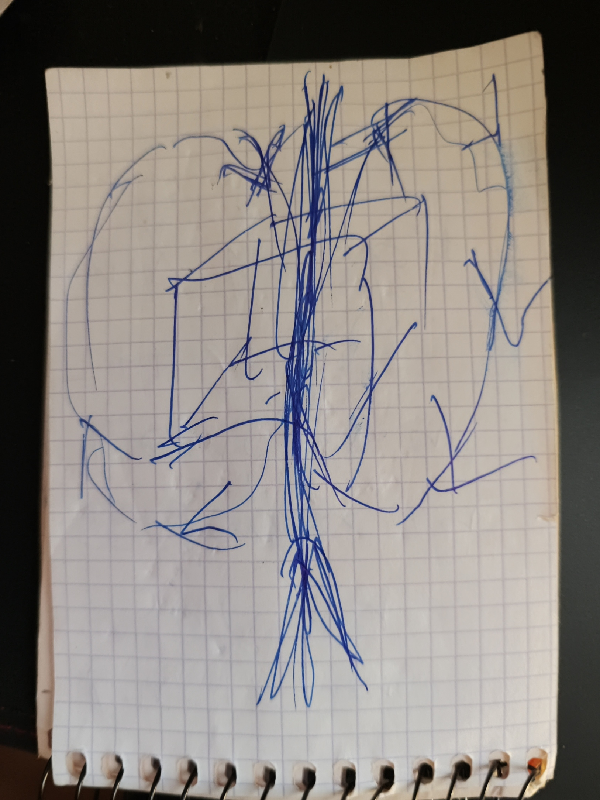

# NeedleSurf v3

02.11.2026 · by Hiroshi Rinzai · v3 text and translations by Claude Opus 5.5 max

[Български](NeedleSurf-v3.bg.md) · [English](NeedleSurf-v3.en.md) · [Español](NeedleSurf-v3.es.md) · [Русский](NeedleSurf-v3.ru.md) · [中文](NeedleSurf-v3.zh.md)

*Перевод с болгарского выполнен Claude. Цитаты — слова автора в переводе; болгарский оригинал — в файле [NeedleSurf-v3.bg.md](NeedleSurf-v3.bg.md).*

NeedleSurf предполагает, что у частицы есть два связанных проявления в разных временных координатах, плюс и минус, и что на самом деле они — одно. Измерение одного позиционирует другое, причём между ними не проходит ни сигнал, ни данные, а внутренний интервал Δ не зависит от расстояния. Время двумерно, и будущего нет. В большом поле частиц пары не отслеживаются: в каждый миг захватываются те частицы в прошлом, которые соответствуют нашим, и так движется целое. Само тело не движется, поэтому ускорение на него не действует: оно внутри, в оболочке. Смена происходит каждую треть Δ, а задержка дольше Δ разрушает целостность.

Текст построен по уточнениям автора от 02.11.2026 и по авторскому тексту v2.3. Цитаты принадлежат ему. Сравнения с физикой, примечания и вопросы добавлены Claude и отмечены как таковые. Что остаётся, решает автор.

## Исходная мысль

> «Я нахожу единственный логичный ответ на вопрос, почему две частицы разделены, синхронизированы, но не могут передавать информацию друг другу. Единственный логичный ответ — потому что они одна частица. Просто одна чем-то отличается от другой. Чем она может отличаться? Единственный ответ — время». — Хироши Риндзай, 02.11.2026

Остальное в тексте вытекает из этой мысли.

## Откуда пришла идея

> «Когда входишь в настоящую форму медитации, где ты уже получил просветление, это у тебя перед глазами, и ты это проживаешь. Там у времени всё ещё есть ход, но не тот ход, что у нас здесь. Там есть только сейчас. Движение всё ещё есть, но нет этого разделения времени. Нет конца, нет начала. Когда ты в этой форме сознания, сам вопрос о начале и конце — глупость». — 02.11.2026

Опыт рождает вопросы, но не заменяет измерения. Так записано и в v2.3, раздел 7.

## Цель

> «Я могу ошибаться. Но я вижу эти повторения повсюду. Пусть будет труд, который их опровергнет или докажет. Пусть останется: вот, мы проверили, это не работает. И это всё равно польза для других исследователей». — 02.11.2026

Цель работы — проверка, а не защита идеи. Отрицательный результат публикуется так же, как положительный.

Что бы ни показала проверка, работа над Временной спиралью и другими проектами продолжается: «Я не отказываюсь от спирали и других вещей». (02.11.2026)

## Одна частица, два проявления

> «Когда у меня есть две частицы, они — одна». — Хироши Риндзай, 02.11.2026

- Есть одна частица с двумя неразрывно связанными проявлениями в разных временных координатах. Автор называет их плюсом и минусом.
- Плюс и минус — названия временной связи между ними. Они заранее не означают ни спин, ни заряд, ни полярность импульса.
- Оба проявления движутся вперёд во времени, с внутренним сдвигом между ними. Это не две одновременные формы в одном общем времени. «Минус» не означает движения назад по лабораторным часам.
- У времени два измерения, а не три: будущего нет. Поэтому схема «прошлое – настоящее – будущее» не используется (уточнение от 02.11.2026).
- Плюс стоит там, где другие ставят ноль. Ноль был бы настоящим как точкой, а настоящее — это поток, и его нельзя рассматривать как точку (02.11.2026).
- В настоящем всё, что существует там, где оно есть, имеет знак плюс. Частица, позиционированная там, где её нет, может иметь только знак минус: будь у неё плюс, она бы уже существовала там (02.11.2026). Это связано с порядком из раздела «Позиционирование через измерение»: сначала измеряется плюс, потому что минуса нет «здесь и сейчас», пока он не позиционирован.
- Образ: время с головой и хвостом. Одно загибается в одну сторону, другое — в другую, а оба продолжают двигаться вперёд. Это образ, а не готовая геометрия или уравнение.

## Рисунок: время течёт через нас

> «Не мы путешествуем через время. Время течёт через нас». — 02.11.2026

- Куб в середине — это объект: «Это я, куб». Средняя стрелка — это путь.
- Два круга — это время. Они проходят через объект и разделяются: один уходит влево, другой вправо. Это образ с головой и хвостом из предыдущего раздела.
- Две частицы, плюс и минус, создаются оттого, что время течёт через нас.
- Объект — единое целое. Плюсы и минусы находятся в нём, а не в отдельных частях вроде атома. Он не разделён на две частицы. Разделено то, что вокруг него, а также воспоминания и то, что ты знаешь: «Но сам ты находишься в одном объекте». Какова технология, пока неизвестно; по словам автора, это новая задача.
- Открыто: когда ты переживаешь поток времени, гравитация не имеет значения, а если смотреть со стороны, ты «застыл». Автор ещё подумает над этим (02.11.2026).
- Открыто: если круги толкают тело в направлении времени и вращаются в одну сторону, возможно, «зубчик» есть только с одной стороны (02.11.2026).
- Открыто: может быть два плюса и один круг, который является минусом (на рисунке он был бы пунктирным). Поэтому автор не отвергает и трёхмерную архитектуру: «Это проявится дальше во времени» (02.11.2026).

## Позиционирование через измерение, без передачи сигнала

> «Нет одного момента. Ты можешь позиционировать его где угодно». — об электроне как образце, 02.11.2026

- Как у электрона нет одного места, пока его не измерят, так и у двух проявлений нет одного момента. Измерение их позиционирует.
- Измерение одного проявления позиционирует другое.
- **От одного к другому не передаётся никакой сигнал и никакие данные.** Это часть гипотезы, а не дополнение.
- Следствие для проверки: раз передачи нет, эффект виден при последующем сравнении двух записей. Запись одного детектора сама по себе не показывает ничего необычного.
- Когда измеряются оба проявления, сначала измеряется плюс, потом минус. Начать с минуса нельзя. Однако порядок двух отсчётов сам по себе не говорит, какое проявление ведёт внутри.

## Внутренний интервал Δ и расстояние

- Между двумя проявлениями есть внутренний временной интервал — здесь он обозначен Δ.
- Гипотеза предполагает, что Δ одинаков при расстоянии 200 тысяч км и 2 миллиарда км. Внешнее расстояние само по себе не определяет внутреннюю временную связь.
- Именно здесь NeedleSurf расходится с обычной физикой. Там задержка между двумя записями следует за путём: свет проходит 200 тысяч км примерно за 0,67 с, а 2 миллиарда км — примерно за 1 ч 51 мин.
- Величина Δ пока не задана. Чтобы отличить «постоянный» от «растёт с расстоянием», нынешних часов достаточно. Чтобы измерить сам Δ, нужно знать хотя бы его порядок.
- Предполагается внутренний слой или поле, в котором два проявления остаются связанными. Оно связывает их, не передавая сигнала. Отсутствие прямого наблюдения его не опровергает; для проверки нужен измеримый эффект, такой как с Δ.

## Не пары, а соответствия в прошлом

> «Мы не ищем соответствующие. Мы ищем те, что в прошлом, но соответствуют нашим, потому что используем их всего на 0,000 и сколько-то там секунд». — 02.11.2026

- Гипотеза не отслеживает определённые пары. Есть поле из огромного числа квантовых частиц (например, 100 миллиардов), в котором совершается путешествие. В каждый момент ищутся те частицы в прошлом, которые в этот миг соответствуют нашим.
- Каждое соответствие используется лишь очень короткое время, доли секунды. Важно только поймать их в тот миг, когда они соответствуют; после этого пойманы уже другие.
- Правило времени: от каждого соответствия переходят к следующему не позже чем через половину разницы Δ, чтобы остался запас. Рабочий ритм — минус, плюс, минус, плюс, со сменой каждую треть Δ: «Чередуем их каждую треть времени и путешествуем куда душе угодно». Если задержаться дольше самой разницы, «мы мертвы»: целостность теряется — «у кого-то на корабле пропадает глаз, у другого рот, у третьего ухо» (02.11.2026). Следствие: чем меньше Δ, тем чаще нужно менять соответствия.
- Чередование: позиционируют там, где частицы нет (минус), потом там, где она есть (плюс), и так далее. «Думаю, логика держится». (02.11.2026)
- Только так может двигаться весь кристалл сразу. С определёнными парами одна часть пошла бы в одну сторону, а другая — в другую, потому что невозможно установить, что пары находятся именно там.
- Так движение может быть куда мы захотим: «Куда хотим, туда и путешествуем».
- Открыто: по какому признаку узнают, что частица в прошлом соответствует нашим, и как движение всего кристалла согласуется с сохранением импульса.

## Тело не движется

> «Тело, конечно, не движется. Именно поэтому на нас и не действует ускорение и так далее». — 02.11.2026

- Движется весь кристалл, а тело находится внутри него и не движется. Поэтому на него не действуют ускорение и тому подобное.
- «Нам нужно поместить его внутрь». Тело помещают в оболочку (shell). Автор хочет сделать её из квантового кристалла.
- Снаружи виден только свет. Так автор объясняет Tic Tac из случая Nimitz: «внутри может быть целый город» (02.11.2026).
- Открыто: как сделать оболочку или «отпечаток» тела другим механизмом. После первой проверки автор хочет обсудить это с молодой женщиной-физиком, автором «Двумерной Вселенной» (см. «Новые идеи»).
- Примечание Claude: ближе всего в литературе — варп-пузырь Алькубьерре (1994). Корабль находится внутри пузыря в свободном падении и не чувствует ускорения, а движется пространство вокруг него. Решение требует «экзотической» материи с отрицательной энергией, и неизвестно, как её получить (см. «Связанные работы»).

## Побратимство и среда, которая его сохраняет, — открыто

- Побратимство — это связь, которая идёт от общего происхождения.
- Связь временная и через какое-то время исчезает. Задача — создать среду, которая сохраняет её столько, сколько нужно.
- Как создать и удержать связь материально, пока неизвестно. Это отдельная гипотеза.

> «Я могу создать эту связь в уме, трудом и убеждённостью, но ещё не знаю, как сделать её материальной». — 02.11.2026

- Автор сравнивает искомый путь с обучением: ходьба становится автоматической после многих повторений.
- Возможные среды, пока как вопросы: кристалл времени (сделать оболочку вокруг связи или войти в него) и топологическая защита, о которой говорится ещё в первой версии от июля. Подробнее — в следующем разделе.

## Ближайшее в существующей физике — сравнения, не доказательства

Эти явления хорошо изучены. Они не доказывают NeedleSurf, а показывают, где в физике уже есть похожая структура.

| Явление | Чем похоже | Чем отличается |
| --- | --- | --- |
| Пары фотонов из одного фотона | Общее происхождение и одно общее состояние («оба — одно»); момент рождения не определён; измерение одного определяет другой без сигнала; видно только при сравнении записей | В стандартной физике нет постоянного интервала Δ, не зависящего от расстояния; отслеживаются определённые пары |
| Пара майорановских состояний (подход Microsoft) | Одно состояние, разделённое между двумя концами проволоки; ни один конец сам его не несёт; считывается только совместно; его защищает топология | Разделение — в пространстве, а не во времени. Получила ли их Microsoft на самом деле, ещё спорят |
| Частые короткие измерения (квантовый эффект Зенона) | Повторяемые короткие измерения «ведут» состояние туда, где его измеряют, — позиционирование через измерение, миг за мигом | Движется квантовое состояние, а не тело в пространстве |
| Время с двумя направлениями (Ааронов) | Настоящее описывается двумя состояниями; из большого множества выбираются те, что совпадают с заданным условием, — выбор по соответствию | Там участвует будущее. В NeedleSurf будущего нет, и выбор делается из прошлого |
| «Одноэлектронная Вселенная» (Уилер — Фейнману, 1940) | Все электроны — один и тот же электрон, который движется вперёд и назад во времени, — разные частицы отличаются только временем | У Уилера одно направление — назад во времени; в NeedleSurf оба проявления идут вперёд. Идея Уилера не принята, потому что позитронов гораздо меньше, чем электронов |

Ни одно из этих явлений не перемещает тело. В NeedleSurf тело тоже не движется: движется весь кристалл, а тело находится внутри него. Это собственная часть NeedleSurf.

## Первая проверка, которая может различить

Здесь пары — только инструмент для проверки интервала Δ, а не механизм движения.

1. Пары фотонов пускают по оптическим волокнам разной длины, а записи сравнивают потом.
2. По обычной физике задержка между двумя записями — это разность путей, делённая на скорость в волокне.
3. По NeedleSurf к ней добавляется Δ, который не меняется, когда меняется путь.
4. Задержки самих приборов измеряют отдельно, например обычным светом через те же волокна. Иначе постоянный Δ в них спрячется.

- За: постоянная добавка при всех длинах, которая остаётся и при перестановке детекторов.
- Против этой версии: при достигнутой точности добавки нет. Тогда Δ меньше этой точности. Это граница, а не опровержение всех версий.
- Механизм движения через соответствия в прошлом требует собственной проверки. Она станет возможной, когда будет определено, по какому признаку узнаётся соответствие.

## Новые идеи, которые ещё не входят в гипотезу

- **Квантовый кристалл Microsoft как «сердце» Временной спирали.** Автор нашёл его, когда искал физическое соответствие SPARK из Living Architecture (02.11.2026). Из него автор хочет сделать оболочку, в которую помещается тело (см. «Тело не движется»).
- **Кристалл времени как среда.** Сделать оболочку вокруг связи или войти в него (02.11.2026).
- **Двумерная Вселенная.** Теория молодой женщины-физика, чьё имя ещё предстоит уточнить. Посмотреть, согласуется ли она с двумерным временем.
- **Теории трёхмерного времени.** Инстинктивно они ему не нравятся, и пока они не входят в гипотезу: у него время двумерно, и будущего нет. Но он не отверг их полностью: «Ещё сидит». Если две частицы соединятся, должно быть и настоящее, а мозг тоже работает с задержками, которые автор ещё не уложил в ритм (02.11.2026).
- **Гравитационные волны и повторение.** Волна существует во всей Вселенной и постоянна, как константа, а в ней есть повторение. Если так, есть множество одинаковых частиц (например, 100 миллиардов). По волне можно найти задержку, а повторение может быть способом находить соответствия в прошлом. Если знать ещё и то, как волна рассеивается в зависимости от пройденного расстояния, можно предсказывать смещение и делать бо́льшие скачки. Идея — по двум фильмам о квантовом процессе при распространении гравитационных волн, просмотренным 02.11.2026; фильмы ещё не указаны. Примечание Claude: по общей теории относительности гравитационные волны распространяются со скоростью света и не испытывают дисперсии по частоте, а их амплитуда убывает обратно пропорционально расстоянию. LIGO и Virgo проверяют это при своих регистрациях.
- **Свет, «застёжка-молния» и Тесла.** Отдельная теория автора о свете и «застёжке-молнии», в которой свет статичен, по его словам, тесно связана с беспроводной передачей энергии Теслы (02.11.2026). Это тема для отдельного текста; её начало — в разговоре «Проверка фотонных экспериментов» (Work\\Photon-text-20261026).
- **Свет и маски.** Если всё есть свет, то Большой взрыв — не взрыв, а развёртывание разных «масок» света, «чтобы нас не изжарить»: гравитация, время, материя и другие. Этим разделением Бог позволил себе быть везде в любое время. По словам автора, идея света пришла вместе с NeedleSurf с самого начала (02.11.2026).
- **Вода, которая светится при сжатии.** При сонолюминесценции пузырёк в воде, сжатый звуковой волной, испускает короткую вспышку света. Автор видит здесь очень интересные совпадения со своей идеей о свете (02.11.2026). Обзор: [Brenner, Hilgenfeldt, Lohse (2002)](https://doi.org/10.1103/RevModPhys.74.425).

## Части прежних текстов — остаются ли

Эти части v2.3 и первой версии не вошли в этот текст. Они не убраны как ошибочные. Просто неясно, какие из них автор считает своими, а какие — чужими добавками.

- Коллайдер: в момент взаимодействия участвует только минус; возможный вклад в недостающую гравитацию и более упорядоченный выход (v2.3, раздел 5).
- Поток и запись, временная спираль, поля памяти и связь с расширением Вселенной (v2.3, раздел 6).
- Роль сознания при записи и доступе к ней (v2.3, раздел 7). Медитативный опыт как источник уже есть в разделе «Откуда пришла идея».
- «Магистраль» из побратимлённых систем и пример с чёрной дырой (v2.3, раздел 8). Они близки к новому разделу о движении всего кристалла.
- Nimitz / Tic Tac как повод (v2.3, раздел 9, и первая версия). Объяснение автора, что снаружи виден только свет, уже есть в разделе «Тело не движется».
- «Остаток», который держит структуры, и проблема иерархии (первая версия, июль).

## Вопросы к автору

1. По какому признаку узнаётся, что частица в прошлом соответствует нашим?
2. Насколько большим может быть Δ — секунды, наносекунды, или ты ещё не знаешь?
3. При двумерном времени плюс — это настоящее как поток. Минус — это прошлое? Ответ автора (02.11.2026): частица, позиционированная там, где её нет, всегда минус; плюс — это то, что уже существует.
4. Как движение всего кристалла согласуется с сохранением импульса? Science спросит это первым. Уточнение автора (02.11.2026): тело не движется, поэтому ускорение на него не действует; оно внутри оболочки. Вопрос об импульсе всего кристалла остаётся.
5. Какие части прежних текстов остаются?
6. Что будет, если задержаться дольше Δ: станет ли минус плюсом там, где мы находимся? Ответ автора (02.11.2026): существовать нельзя, целостность теряется (см. «Правило времени»). Это не пробуют.
7. «Отпечаток» тела: в оболочку помещается само тело или его отпечаток в кристалле, который затем позиционируется?
8. Свет, видимый снаружи: его излучает оболочка или он возникает при смене соответствий?

## Связанные работы

Работы, которые описывают, проверяют или ограничивают идеи, близкие к NeedleSurf. Они — отправная точка для глубокого поиска в литературе. Применимы ли их условия к NeedleSurf, ещё предстоит проверить.

- [Stefanov, Zbinden, Gisin, Suarez (2002)](https://arxiv.org/abs/quant-ph/0110117) — эксперимент, который опроверг теорию Суареса, где порядок измерений имеет физический смысл. Близко к «сначала плюс, потом минус». [Ответ Суареса](https://arxiv.org/abs/quant-ph/0112150)
- [Megidish et al. (2013)](https://arxiv.org/abs/1209.4191) — запутанность фотонов, которые никогда не существовали одновременно
- [Salart et al. (2008)](https://arxiv.org/abs/0808.3316) — нижняя граница скорости гипотетического «влияния» между спаренными фотонами на расстоянии 18 км. [Комментарий к эксперименту](https://arxiv.org/abs/0810.4452)
- [Bancal et al. (2012)](https://doi.org/10.1038/nphys2460) — любое объяснение через «влияние» с конечной скоростью ведёт к передаче сигнала. Внутреннее поле не может быть таким влиянием
- [Tegmark (1997)](https://arxiv.org/abs/gr-qc/9702052) — более одного временного измерения делает физику непредсказуемой. Это ограничение, если двумерное время понимать как два временных измерения в физическом смысле
- [Kletetschka (2025)](https://www.sci.news/physics/three-dimensional-time-14011.html) — теория трёхмерного времени, в которой три измерения — не прошлое, настоящее и будущее
- [Feynman, Нобелевская лекция (1965)](https://www.nobelprize.org/prizes/physics/1965/feynman/lecture/) — рассказ об идее Уилера, что все электроны — один и тот же электрон
- [Alcubierre (1994)](https://arxiv.org/abs/gr-qc/0009013) — варп-пузырь в общей теории относительности: корабль находится внутри и не чувствует ускорения, а пространство перед ним сжимается и позади расширяется. Требует «экзотической» материи с отрицательной энергией

## Источники

- Уточнения автора в разговоре с Claude 02.11.2026
- NeedleSurf v2.3 (03.10.2026): авторский текст, вопросы и логическая проверка в папке Needle\_Surf\_v.2 в Codex
- Первая версия, 25–26.07.2026: [aliceisback/Needle-Surf](https://github.com/aliceisback/Needle-Surf)
- Y. Aharonov, P. G. Bergmann, J. L. Lebowitz, [Time Symmetry in the Quantum Process of Measurement](https://doi.org/10.1103/PhysRev.134.B1410), Phys. Rev. 134, B1410 (1964)
- J. D. Franson, [Bell Inequality for Position and Time](https://doi.org/10.1103/PhysRevLett.62.2205), Phys. Rev. Lett. 62, 2205 (1989)
- B. Misra, E. C. G. Sudarshan, [The Zeno's paradox in quantum theory](https://doi.org/10.1063/1.523304), J. Math. Phys. 18, 756 (1977)
- [Majorana 1](https://en.wikipedia.org/wiki/Majorana_1) — чип Microsoft и спор вокруг результатов
