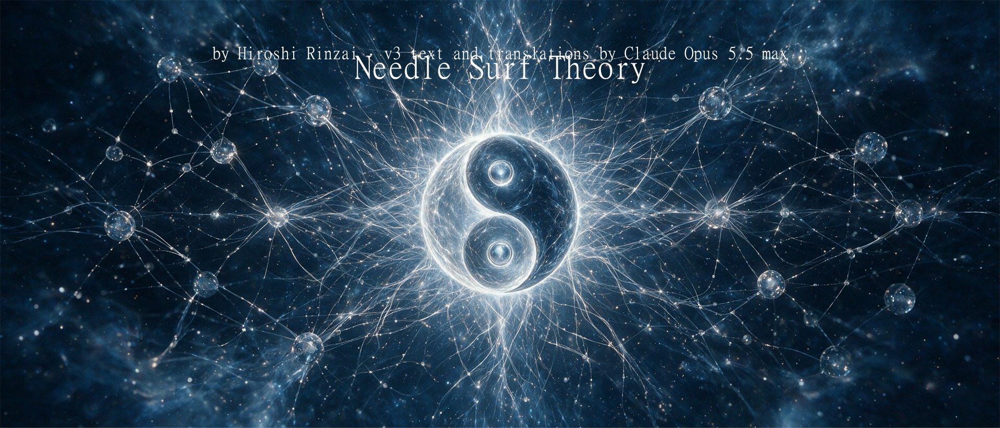
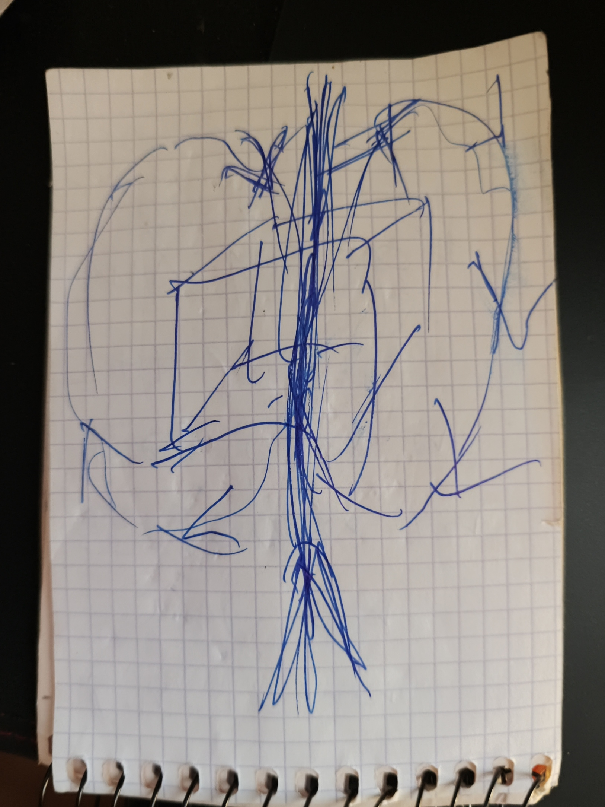

# NeedleSurf v3

2026 年 11 月 2 日 · by Hiroshi Rinzai · v3 text and translations by Claude Opus 5.5 max

[Български](NeedleSurf-v3.bg.md) · [English](NeedleSurf-v3.en.md) · [Español](NeedleSurf-v3.es.md) · [Русский](NeedleSurf-v3.ru.md) · [中文](NeedleSurf-v3.zh.md)

*本文由 Claude 从保加利亚语译出。引文是作者原话的译文；保加利亚语原文见 [NeedleSurf-v3.bg.md](NeedleSurf-v3.bg.md)。*

NeedleSurf 提出：一个粒子在不同的时间坐标上有两个相互关联的显现，即“正”与“负”，而两者实际上是同一个。测量其中一个就会定位另一个，两者之间不传递任何信号或数据；内部间隔 Δ 与距离无关。时间是二维的，未来并不存在。在巨大的粒子场中，并不追踪特定的粒子对：每一瞬间都去捕捉过去中与我们的粒子相对应的那些粒子，整体就是这样移动的。物体本身并不移动，因此不受加速度的影响：它在里面，在一个外壳中。每隔 Δ 的三分之一切换一次，停留超过 Δ 会破坏完整性。

本文依据作者 2026 年 11 月 2 日的说明和 v2.3 的作者原文整理。引文出自作者本人。与物理学的比较、注释和问题由 Claude 添加，并已注明。哪些内容保留，由作者决定。

## 出发点

> “我找到了一个唯一合乎逻辑的答案，来回答这个问题：为什么两个粒子彼此分开、保持同步，却不能相互传递信息。唯一合乎逻辑的答案是：因为它们是同一个粒子。只是其中一个在某一方面与另一个不同。它能在什么方面不同？唯一的答案是时间。”——Hiroshi Rinzai，2026 年 11 月 2 日

文中其余内容都由这一想法推出。

## 想法从何而来

> “当你进入真正的冥想状态，在那里你已经得到了开悟，这个东西就在你眼前，你在亲身经历它。在那里，时间仍然在流动，但不是我们在这里的那种流动。那里只有现在。仍然有运动，但没有这种对时间的划分。没有终点，也没有起点。当你处在这种意识状态时，‘有开始和结束’这个问题本身就是荒谬的。”——2026 年 11 月 2 日

体验会引出问题，但不能代替测量。v2.3 第 7 节也是这样写的。

## 目的

> “我可能是错的。但我到处都看到这些重复。让我们有一项工作来否定它们或者证明它们。让它留下记录：看，我们检验过了，这行不通。这对其他研究者也仍然有用。”——2026 年 11 月 2 日

这项工作的目的是检验，而不是为这个想法辩护。否定的结果和肯定的结果一样要发表。

无论检验结果如何，时间螺旋和其他项目的工作都会继续：“我不会放弃螺旋和其他东西。”（2026 年 11 月 2 日）

## 一个粒子，两个显现

> “当我拥有这两个粒子时，它们是同一个。”——Hiroshi Rinzai，2026 年 11 月 2 日

- 存在一个粒子，它在不同的时间坐标上有两个不可分割地相连的显现。作者称之为“正”与“负”。
- “正”与“负”是对两者之间时间关系的称呼。它们并不预先表示自旋、电荷或脉冲的极性。
- 两个显现都在时间中向前运动，彼此之间有一个内部错位。它们不是同一共同时间中的两个同时形式。“负”并不意味着在实验室时钟上向后运动。
- 时间有两个维度，而不是三个：未来并不存在。因此不使用“过去—现在—未来”的框架（2026 年 11 月 2 日的说明）。
- “正”位于别人放“零”的位置。“零”会是作为一个点的现在，而现在是一股流，不能被当作一个点来看待（2026 年 11 月 2 日）。
- 在现在，凡是在其所在之处存在的东西，都带“正”号。一个被定位在它不存在之处的粒子，只能带“负”号：如果它带“正”号，它早已存在于那里了（2026 年 11 月 2 日）。这与“通过测量定位”一节中的顺序相吻合：先测量“正”，因为在被定位之前，“负”并不在“此时此地”。
- 意象：有头有尾的时间。一个向一边弯曲，另一个向另一边弯曲，而两者都继续向前。这是一个意象，不是现成的几何或方程。

## 手绘图：时间流过我们

> “不是我们穿越时间，而是时间流过我们。”——2026 年 11 月 2 日

- 中间的立方体是物体：“这就是我，这个立方体。”中间的箭头是路径。
- 两个圆是时间。它们穿过物体并分开：一个向左，另一个向右。这就是上一节中“有头有尾”的意象。
- 两个粒子，即“正”与“负”，是因为时间流过我们而产生的。
- 物体是一个整体。“正”与“负”都在它里面，而不是在像原子那样的单独部分里。它没有被分成两个粒子。被分开的是它周围的东西，还有记忆和你所知道的东西：“但你自己是在一个物体之中。”技术是什么，目前还不知道；按作者的说法，这是一个新任务。
- 待解决：当你经历时间之流时，引力并不重要，而从旁边看，你是“冻结”的。作者还会继续思考这一点（2026 年 11 月 2 日）。
- 待解决：如果这些圆把物体朝时间的方向推动，并且朝一个方向旋转，也许“齿”只在一侧（2026 年 11 月 2 日）。
- 待解决：可能有两个“正”和一个代表“负”的圆（在图中会用虚线画出）。正因如此，作者也不否定三维结构：“这会在以后的时间里显现出来。”（2026 年 11 月 2 日）

## 通过测量定位，不传递信号

> “不存在单一的时刻。你可以把它定位在任何地方。”——以电子为范例，2026 年 11 月 2 日

- 正如电子在被测量之前没有一个确定的位置，这两个显现也没有一个确定的时刻。测量对它们进行定位。
- 测量一个显现，就会定位另一个显现。
- **从一个到另一个不传递任何信号或数据。** 这是假说本身的一部分，而不是补充。
- 对检验的推论：既然没有传递，效应只有在事后比较两份记录时才能看到。单个探测器的记录本身不会显示任何异常。
- 当测量两个显现时，先测量“正”，再测量“负”。不能从“负”开始。不过，两次读数的先后顺序本身并不说明哪个显现在内部领先。

## 内部间隔 Δ 与距离

- 两个显现之间有一个内部时间间隔，这里记作 Δ。
- 该假说提出：无论距离是 20 万公里还是 20 亿公里，Δ 都是相同的。外部距离本身并不决定内部的时间联系。
- 这正是 NeedleSurf 与普通物理学的分歧所在。在普通物理学中，两份记录之间的延迟取决于路径：光走 20 万公里约需 0.67 秒，走 20 亿公里约需 1 小时 51 分钟。
- Δ 的大小尚未给出。要区分“恒定”和“随距离增长”，现今的时钟已经足够。要测量 Δ 本身，至少需要知道它的数量级。
- 假定存在一个内部层或场，两个显现在其中保持相连。它使两者相连，而不传递信号。缺乏直接观测并不能否定它；检验需要一个可测量的效应，比如与 Δ 有关的效应。

## 不是成对，而是过去中的对应

> “我们不寻找相对应的那些。我们寻找的是那些在过去、却与我们的相对应的粒子，因为我们只用它们零点零零零几秒。”——2026 年 11 月 2 日

- 该假说不追踪特定的粒子对。存在一个由极大数量的量子粒子（例如 1000 亿个）组成的场，人们在其中穿行。每一时刻都去寻找那些在这一瞬间与我们的粒子相对应的、过去中的粒子。
- 每个对应只使用很短的时间，即几分之一秒。重要的只是在它们相对应的那一瞬间抓住它们；之后抓住的就已经是别的粒子了。
- 时间规则：从每个对应转到下一个，最迟不超过差值 Δ 的一半，以留出余量。工作节奏是负、正、负、正，每隔 Δ 的三分之一切换一次：“我们每隔三分之一的时间交替一次，想去哪儿就去哪儿。”如果停留的时间超过差值本身，“我们就死了”：完整性会丧失——“飞船上有人的眼睛消失了，有人的嘴消失了，还有人的耳朵消失了”（2026 年 11 月 2 日）。推论：Δ 越小，就越需要频繁地更换对应。
- 交替：先定位在没有粒子的地方（负），然后定位在有粒子的地方（正），如此往复。“我认为逻辑是成立的。”（2026 年 11 月 2 日）
- 只有这样，整个晶体才能一起移动。如果用特定的粒子对，一部分会往一个方向走，另一部分会往另一个方向走，因为无法确定这些粒子对恰好就在那里。
- 这样，运动可以朝向我们想去的任何地方：“我们想去哪里，就到哪里。”
- 待解决：如何识别过去中的某个粒子与我们的粒子相对应，以及整个晶体的运动如何与动量守恒相协调。

## 物体并不移动

> “物体当然不会移动。正因为如此，加速度之类的才不会影响我们。”——2026 年 11 月 2 日

- 移动的是整个晶体，而物体在晶体内部，并不移动。因此加速度之类的力不会作用于它。
- “我们必须把它放进里面。”物体被放进一个外壳（shell）中。作者想用量子晶体来制作这个外壳。
- 从外面只能看到光。作者用这一点来解释 Nimitz 事件中的 Tic Tac：“里面可能有一整座城市”（2026 年 11 月 2 日）。
- 待解决：如何制作外壳，或者用别的机制制作物体的“印记”。在第一次检验之后，作者想和提出“二维宇宙”的那位年轻女物理学家讨论此事（见“尚未纳入假说的新想法”）。
- Claude 的注释：文献中最接近的是阿库别瑞（Alcubierre）的曲速泡（1994）。飞船位于泡内，处于自由落体状态，感觉不到加速度，而运动的是它周围的空间。这一解需要具有负能量的“奇异”物质，目前还不知道如何获得（见“相关研究”）。

## 结拜及保护它的环境——尚待解决

- 结拜是一种源于共同起源的联系。
- 这种联系是暂时的，过一段时间就会消失。任务是创造一种环境，让它在需要的时间内得以保持。
- 如何在物质上建立并保持这种联系，目前尚不清楚。这是一个单独的假说。

> “我可以在头脑中建立这种联系，靠努力和信念，但我还不知道如何把它变成物质的。”——2026 年 11 月 2 日

- 作者把所寻找的道路比作学习：走路在多次重复之后会变得自动。
- 可能的环境，目前仍作为问题提出：时间晶体（在联系周围做一个外壳，或者进入其中）和拓扑保护——早在 7 月的第一版中就提到过。更多内容见下一节。

## 现有物理中最接近的现象——是比较，不是证明

这些现象已被充分研究。它们并不证明 NeedleSurf，而是显示物理学中哪里已经存在类似的结构。

| 现象 | 相似之处 | 不同之处 |
| --- | --- | --- |
| 由一个光子产生的光子对 | 共同起源和一个共同状态（“两者是一”）；产生的时刻不确定；测量一个就确定另一个，无需信号；只有比较记录时才能看到 | 标准物理中没有与距离无关的恒定间隔 Δ；追踪的是特定的粒子对 |
| 一对马约拉纳态（微软的方法） | 一个状态分布在导线的两端；任何一端都不单独携带它；只能共同读取；由拓扑保护 | 分离发生在空间中，而不是在时间中。微软是否真正获得了它们，仍有争议 |
| 频繁的短时测量（量子芝诺效应） | 反复的短时测量把状态“引导”到测量的方向——通过测量定位，一瞬接一瞬 | 移动的是量子态，而不是空间中的物体 |
| 双向时间（阿哈罗诺夫） | 现在由两个状态描述；从一个大集合中选出符合给定条件的那些——按对应来选择 | 在那里未来参与其中。在 NeedleSurf 中未来并不存在，选择来自过去 |
| “单电子宇宙”（惠勒对费曼说，1940 年） | 所有电子都是同一个电子，它在时间中向前和向后运动——不同的粒子只在时间上不同 | 在惠勒那里，一个方向是在时间中向后；在 NeedleSurf 中，两个显现都向前。惠勒的想法未被接受，因为正电子远少于电子 |

这些现象没有一个能移动物体。在 NeedleSurf 中物体同样不移动：移动的是整个晶体，而物体在晶体内部。这是 NeedleSurf 自己的部分。

## 第一个能作出区分的检验

这里的粒子对只是检验间隔 Δ 的工具，而不是运动的机制。

1. 让光子对通过不同长度的光纤，事后比较记录。
2. 按照普通物理学，两份记录之间的延迟等于路径差除以光纤中的速度。
3. 按照 NeedleSurf，在此之外还有一个附加量 Δ，路径改变时它不变。
4. 仪器本身的延迟要单独测量，例如用普通光通过同样的光纤。否则恒定的 Δ 会隐藏在其中。

- 支持：在所有长度下都有一个恒定的附加量，并且交换探测器后依然存在。
- 反对这一版本：在已达到的精度下没有附加量。那么 Δ 小于这一精度。这是一个界限，而不是对所有版本的否定。
- 通过过去中的对应来运动的机制需要单独的检验。在确定如何识别对应之后，这种检验才成为可能。

## 尚未纳入假说的新想法

- **微软的量子晶体作为时间螺旋的“心脏”。** 作者是在为 Living Architecture 的 SPARK 寻找物理对应物时发现它的（2026 年 11 月 2 日）。作者想用它来制作放置物体的外壳（见“物体并不移动”）。
- **时间晶体作为环境。** 在联系周围做一个外壳，或者进入其中（2026 年 11 月 2 日）。
- **二维宇宙。** 一位年轻女物理学家的理论，她的名字尚待确认。需要看它是否与二维时间相契合。
- **三维时间理论。** 作者本能地不喜欢这些理论，目前它们不属于他的假说：在他看来，时间是二维的，未来并不存在。但他并没有完全否定它们：“它还在那里。”如果两个粒子结合在一起，就应该也存在现在；而且大脑的工作也有延迟，作者还没有把这一点纳入某种节奏（2026 年 11 月 2 日）。
- **引力波与重复。** 引力波存在于整个宇宙中，像常数一样恒定，而其中存在重复。如果是这样，就存在大量相同的粒子（例如 1000 亿个）。从引力波中可以求出延迟，而重复可能就是寻找过去中对应的方法。如果还知道波随传播距离如何弥散，就可以预测偏移，并进行更大的跳跃。这个想法来自 2026 年 11 月 2 日观看的两部关于引力波传播中量子过程的影片；影片名称尚未提供。Claude 的注释：根据广义相对论，引力波以光速传播，不随频率发生色散，其振幅与距离成反比衰减。LIGO 和 Virgo 在其探测中检验这一点。
- **光、“拉链”与特斯拉。** 作者关于光和“拉链”的独立理论认为光是静止的；按他的说法，这一理论与特斯拉的无线能量传输密切相关（2026 年 11 月 2 日）。这是另一篇文本的主题；它的开端在“光子实验的检验”这次对话中（Work\\Photon-text-20261026）。
- **光与面具。** 如果一切都是光，那么大爆炸并不是爆炸，而是光的各种“面具”的铺展，“免得把我们烤焦”：引力、时间、物质等等。通过这种划分，上帝让自己可以在任何时间存在于任何地方。按作者的说法，关于光的想法从一开始就和 NeedleSurf 一起出现（2026 年 11 月 2 日）。
- **受压时发光的水。** 在声致发光现象中，水中的气泡被声波压缩时会发出短暂的闪光。作者在这里看到了与他关于光的想法之间非常有趣的巧合（2026 年 11 月 2 日）。综述：[Brenner, Hilgenfeldt, Lohse (2002)](https://doi.org/10.1103/RevModPhys.74.425)。

## 早期文本中的部分——是否保留

v2.3 和第一版中的这些部分没有收入本文。它们并不是因为错误而被删除的。只是还不清楚其中哪些是作者认为属于自己的，哪些是别人添加的。

- 对撞机：在相互作用的瞬间，只有“负”参与；可能对缺失的引力有所贡献，并带来更有序的输出（v2.3，第 5 节）。
- 流与记录、时间螺旋、记忆场，以及与宇宙膨胀的联系（v2.3，第 6 节）。
- 意识在记录和访问记录中的作用（v2.3，第 7 节）。作为来源的冥想体验已写入“想法从何而来”一节。
- 由结拜系统构成的“高速公路”和黑洞的例子（v2.3，第 8 节）。它们与关于整个晶体运动的新一节很接近。
- Nimitz / Tic Tac 事件作为起因（v2.3，第 9 节，以及第一版）。作者关于从外面只能看到光的解释，已写入“物体并不移动”一节。
- 维系结构的“剩余物”，以及等级问题（第一版，7 月）。

## 向作者提出的问题

1. 如何识别过去中的某个粒子与我们的粒子相对应？
2. Δ 可能有多大——几秒、几纳秒，还是你还不知道？
3. 在二维时间中，“正”是作为流的现在。“负”是过去吗？作者的回答（2026 年 11 月 2 日）：被定位在它不存在之处的粒子总是“负”；“正”是已经存在的东西。
4. 整个晶体的运动如何与动量守恒相协调？Science 会首先问这个问题。作者的说明（2026 年 11 月 2 日）：物体并不移动，因此不受加速度影响；它在外壳之内。整个晶体的动量问题仍然存在。
5. 早期文本中哪些部分保留？
6. 如果停留超过 Δ 会怎样——“负”会不会在我们所在之处变成“正”？作者的回答（2026 年 11 月 2 日）：无法存在，完整性会丧失（见“时间规则”）。这不能尝试。
7. 物体的“印记”：放进外壳的是物体本身，还是它在晶体中的印记，然后再对其进行定位？
8. 从外面看到的光：是外壳发出的，还是来自对应的切换？

## 相关研究

描述、检验或限制与 NeedleSurf 相近想法的研究。它们是深入文献检索的起点。它们的条件是否适用于 NeedleSurf，仍有待检验。

- [Stefanov, Zbinden, Gisin, Suarez (2002)](https://arxiv.org/abs/quant-ph/0110117)——否定了苏亚雷斯理论的实验，在该理论中测量的先后顺序具有物理意义。这与“先正后负”很接近。[苏亚雷斯的回应](https://arxiv.org/abs/quant-ph/0112150)
- [Megidish et al. (2013)](https://arxiv.org/abs/1209.4191)——从未同时存在过的光子之间的纠缠
- [Salart et al. (2008)](https://arxiv.org/abs/0808.3316)——相距 18 公里的成对光子之间假想“影响”速度的下限。[对该实验的评论](https://arxiv.org/abs/0810.4452)
- [Bancal et al. (2012)](https://doi.org/10.1038/nphys2460)——任何用有限速度“影响”来解释的方案都会导致信号传递。内部场不可能是这种影响
- [Tegmark (1997)](https://arxiv.org/abs/gr-qc/9702052)——多于一个时间维度会使物理学变得不可预测。如果把二维时间理解为物理意义上的两个时间维度，这就是一个限制
- [Kletetschka (2025)](https://www.sci.news/physics/three-dimensional-time-14011.html)——三维时间理论，其中三个维度并不是过去、现在和未来
- [Feynman，诺贝尔奖演讲 (1965)](https://www.nobelprize.org/prizes/physics/1965/feynman/lecture/)——讲述惠勒关于所有电子都是同一个电子的想法
- [Alcubierre (1994)](https://arxiv.org/abs/gr-qc/0009013)——广义相对论中的曲速泡：飞船位于泡内，感觉不到加速度，而它前方的空间收缩、后方的空间膨胀。需要具有负能量的“奇异”物质

## 来源

- 作者于 2026 年 11 月 2 日在与 Claude 的对话中所作的说明
- NeedleSurf v2.3（2026 年 10 月 3 日）：Codex 中 Needle\_Surf\_v.2 文件夹里的作者原文、问题和逻辑检验
- 第一版，2026 年 7 月 25–26 日：[aliceisback/Needle-Surf](https://github.com/aliceisback/Needle-Surf)
- Y. Aharonov, P. G. Bergmann, J. L. Lebowitz, [Time Symmetry in the Quantum Process of Measurement](https://doi.org/10.1103/PhysRev.134.B1410), Phys. Rev. 134, B1410 (1964)
- J. D. Franson, [Bell Inequality for Position and Time](https://doi.org/10.1103/PhysRevLett.62.2205), Phys. Rev. Lett. 62, 2205 (1989)
- B. Misra, E. C. G. Sudarshan, [The Zeno's paradox in quantum theory](https://doi.org/10.1063/1.523304), J. Math. Phys. 18, 756 (1977)
- [Majorana 1](https://en.wikipedia.org/wiki/Majorana_1)——微软的芯片及围绕其结果的争议
